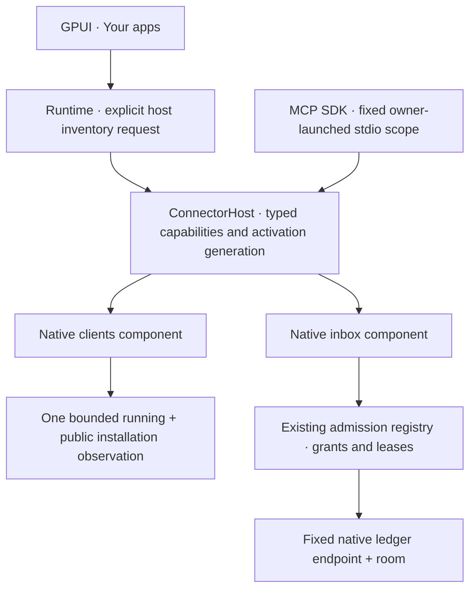

# Rust connector components

The owner [install artifact exporter](MCP_ARTIFACT_EXPORTS.md) packages the existing native inbox for Claude Desktop or Antigravity. It reuses the fixed configuration and binary pin without creating a connector descriptor, parallel registry, grant, identity record or observation store. Human installation and actual client acceptance remain separate.

The native GPUI host uses built-in Rust connector components. This implements the host and feature separation from the Captionizm plugin architecture, `CHWG-PRD-PLUGIN-0.2.0` / `CHWG-PLUGIN-1`. The reference document is Studio `docuswiki/wiki/projects/Chinwag/prd/chinwag-plugin-architecture-and-seatbelt-isolation-prd.md` (SHA256 `57289933603cd44a6d91e98a3ea2a2468306aea53f1b63213923e100a9032e86`). GPUI replaces the reference's Dioxus-specific UI layer.

## Ownership

`chinwag-connectors` owns versioned built-in descriptors, enablement, activation generations and typed capability dispatch. It receives the host's existing registry. It does not create a parallel agent identity database. The runtime and an independently owner-launched MCP process are separate authority domains; this is not a distributed admission service.

The native-clients descriptor declares running and installed metadata reads. One explicit invocation collects each shared source once. Application-family matchers consume the observations; they do not each rescan the machine. The native-inbox descriptor declares only inbox read. Enabling a descriptor does not grant a destination, authenticate a client or change a sender.

The host checks capability, enablement, activation generation and monotonic deadline before and after the synchronous service call. Inbox calls additionally require the exact registered connection, binding generation, destination and unexpired grant/lease. Disabling inbox access revokes its grants. Re-enabling the component cannot restore those grants. Inventory and unrelated capabilities remain independent.

The metadata invocation's eight-second deadline rejects a late result. It does not interrupt a synchronous filesystem operation already in progress. Collection has explicit entry and byte caps; interruptible native collection remains separate work.

The MCP SDK owns MCP framing and negotiation. The existing bounded blocking reader retains cancellation, EOF and shutdown ownership. Initialization and tool listing perform no bus reads. Tool arguments cannot select another endpoint, room, account or sender.

## Installed and running applications

The Darwin collector reads current-user process metadata, depth-one public application directories, bounded public `Info.plist` fields and fixed CLI filenames in explicit directories. It does not read process arguments/environments, private chat/session/persona stores or credentials, and does not execute candidates or a login shell. Public metadata is matched conservatively; it is a family hint, not vendor signature verification.

Installations retain canonical location, aliases, public metadata fingerprint and observed executable stat metadata on the host. Physical copies remain separate. Exact bundle/executable relationships associate running instances. A bounded sample that lacks a matching process reports **running not observed**; it does not prove an application is asleep or safe to launch twice.

The HTTP response exposes only opaque host-qualified observation IDs, family/kind, running-instance counts and bounded coverage. Paths, PIDs, UID, boot UUID, bundle IDs and executable metadata stay host-local. Installation observation failure leaves the running inventory usable and visible as partial capability. The configured Studio endpoint returns Studio metadata; no MacBook fallback runs.

Explicitly negotiated discovery details add optional public directory-category and version hints. The directory category contains no path or username, and version text must pass the bounded shared version-shape validator. Earlier clients receive the original response shape; new clients accept an older runtime without the hints. Human opening refreshes the selected exact copy before durable attempt creation. Changed metadata or a superseded UI selection requires reselection rather than substitution.

GPUI groups rows by family for presentation. Original instance and installation identities remain distinct. Installed, running, protocol-capable, authenticated, connected and message-delivered are separate states.

## Implemented boundaries and remaining work

This check-in implements trusted linked components. It does not implement external `.cwplugin` loading, independently updated workers, dynamic libraries, signed archives, TUF, Seatbelt containment or release-key handling. The descriptor schema is `chinwag-builtin-connector/v1`, distinct from the reference's signed archive manifest. No external-package fallback exists.

Human onboarding uses the separate `chinwag-native-launch` component for supported exact-copy opening. The runtime owns its human-action boundary, exact public reobservation, persistent consumed attempts and optional native main queue. This is a host function, not a newly granted native-open capability in the two read-only descriptors above. GPUI offers the action only for eligible IDs from the selected host; neither discovery nor component enablement dispatches it. See [HUMAN_ONBOARDING.md](HUMAN_ONBOARDING.md).

Client-specific bindings, lifecycle invalidation and scoped remote publication remain separate work. Reused applications remain externally owned and must not be terminated on disconnect. Opening an application is separate from connecting its protocol.

The current shared MCP route is owner-local, unattributed and read-only. Its successful SDK fixture/native-ledger read does not establish that a named GPT/Claude/Gemini client enrolled or that Grok Bot received a group message. General remote ingress is not exposed by these loopback-only alpha services.

The human Cursor setup handoff uses that same fixed-room Rust stdio server. It is a host-native action with separate owner opt-ins and durable action namespace, not a new registry, publication capability or external plugin loader. The selected application receives Cursor's supported install URI through exact-application dispatch; only Cursor can approve it. See [CURSOR_MCP_SETUP.md](CURSOR_MCP_SETUP.md). OS acknowledgment is not connector admission or actual client handshake evidence.

The VS Code setup handoff reuses that Rust server and the existing native-action controller. Its paired owner options, exact VS Code family filter, supported install URI, and immutable journal domain remain separate from ordinary opening and Cursor setup. It adds no registry, grant type, client configuration reader, or automatic tool call. OS acknowledgment disables duplicate setup but proves no registration, trust approval, or inbox read. Source integration and testing are in progress; deployment and actual VS Code acceptance remain unproven. See [VS Code setup](VSCODE_MCP_SETUP.md).

## Verification

Relevant Rust fixtures cover disabled/undeclared capabilities, stale invocations, post-call expiry, exact inbox scope, revocation, cancellation/EOF, public metadata bounds and aliases, partial installed discovery, redaction, host qualification and family grouping. Runtime and MCP reads migrate through the component host in this change. Product services, tests and launcher remain Rust with the pinned Rust1.97.1 toolchain and existing dependency versions.

The MCP inbox result includes bounded in-process connection observations from the existing SDK hooks. Observation is not a new capability or registry and cannot renew a lease or restore permission. See [MCP connection observations](MCP_CONNECTION_OBSERVATIONS.md).

The optional [runtime-owned HTTP inbox](MCP_HTTP_BINDING.md) injects the same host and registry used by runtime discovery into the held InboxServer. Its private HTTP capability is an unattributed owner-local authority, distinct from stdio authority in canonical admission and dispatch. The transport creates no parallel identity registry. Its native status GET reads that same held server; it cannot observe or attach an independently launched stdio child. This source unit is staged, with named-client acceptance separate.

## Separate human steering authority

The legacy already-initialized `SteerController` accepts IO exclusively delegated by its protocol owner and a separate human-control scope for one thread. Discovery, MCP inbox grants, bus messages, and descriptor enablement cannot create that scope. The controller consumes an exact operation before one native active-turn steer; it has no process, initialization, thread-start, GUI-adoption, or arbitrary RPC API. It uses its own action journal rather than an agent identity registry. The dedicated owner-selected human-work entry is described below. Actual changed-work acceptance remains future work. See [Codex steering](CODEX_STEERING.md).

The native human-owned Codex work entry adds a distinct privileged human-action boundary over a declared owner Unix transport. It creates a fresh thread only after consumed Start intent and uses exact per-action control for its initial work lifetime. Metadata and InboxRead descriptors cannot authorize it. It adds no identity registry, discovery scan, server launcher, client-config access or generic RPC. See [human-owned Codex work](CODEX_OWNED_WORK.md).

The explicit Claude work entry owns a separate fresh CLI child only after human Start and persisted startup policy. It uses Claude session/UUID input and evidence types, without fabricating Codex expected-turn targets or Core acknowledgements. Its busy direction request can interrupt or move to a following turn. Metadata, inbox grants and bus content cannot mint its human-input authority. This source adds no existing-session adoption, generic control API or identity registry. See [owned Claude work](CLAUDE_OWNED_WORK.md).
