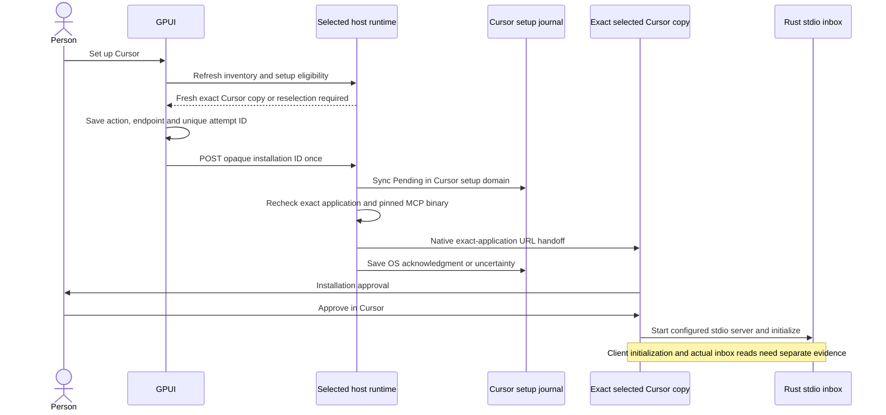

# Cursor native inbox setup

Chinwag can ask an exact selected Cursor application copy to install its Rust native-inbox MCP server. This is an explicit human setup action. Cursor displays its own installation approval. Chinwag does not inspect or edit Cursor's configuration, approve the installation, change tool permissions or restart Cursor.



## Human flow

In an owner-enabled runtime, **Find apps** identifies supported Cursor copies. **Set up Cursor** refreshes the chosen copy and eligibility before creating an attempt. A changed or missing copy requires reselection. Cursor receives the setup request through the operating system's exact-application interface; Chinwag does not use the globally registered URL handler.

After an OS acknowledgment, the UI says **Check Cursor to approve setup; connection unconfirmed**. If the request is unclear, use the saved attempt's status check. It performs only a GET. Reconnecting or restarting Chinwag never automatically submits the installation again. An unresolved attempt blocks both ordinary opening and setup for that same installation.

Cursor's installation dialog and existing access policies remain in force. Follow any client-requested reload or restart yourself. Reused applications remain externally owned by the person.

## Owner-enabled runtime

Setup is disabled by default. In addition to the native opening options described in [HUMAN_ONBOARDING.md](HUMAN_ONBOARDING.md), supply both:

```text
--cursor-mcp-binary /absolute/owned/chinwag-bus-mcp
--cursor-mcp-journal /absolute/private/cursor-setup-journal
```

The setup journal must be distinct from the ordinary opening journal. Immutable domain markers prevent either action from adopting the other's receipts after restart. Unmarked legacy opening records can be read only by the ordinary-opening domain. Unknown, partial or conflicting domain metadata disables that controller and preserves its bytes.

The declared MCP binary must be a bounded, regular native executable owned by the runtime user, with owner execute permission and no group or other write permission. Its file identity, metadata and SHA256 are pinned and checked again before handoff. This protects the declared launch specification from replacement; it does not establish a vendor signature or future executable integrity after installation.

The generated configuration is fixed:

```text
server name: chinwag-native-inbox-mgmt
type: stdio
command: the exact owner-declared Rust MCP executable
args: --bus-url http://127.0.0.1:<this-runtime-port>
      --allow-room #mgmt --lease-seconds 900
```

The endpoint belongs to the selected runtime host, where Cursor and its child execute. A MacBook forwarding address is not substituted for a Studio-local route. Port zero cannot provide a persistent child endpoint and leaves setup disabled. No environment file, shell wrapper, credentials, interpolation, sender or model arguments are generated.

Cursor's documented URI receives the inner stdio configuration as JSON encoded with standard Base64 and URL query encoding. The server name is a separate query parameter. The configuration contains no `mcpServers` wrapper. The generated URI remains host-local and cannot be supplied by an HTTP caller.

## Native loopback interface

| Route | Result |
| --- | --- |
| `GET /api/onboarding/cursor-mcp/status` | Read eligible opaque Cursor installation IDs; no scan or installation. |
| `POST /api/onboarding/cursor-mcp/setup` | Consume one human setup attempt with one opaque installation ID and request ID. |
| `GET /api/onboarding/cursor-mcp/setups/<request ID>` | Read the original attempt receipt; never dispatch a setup request. |

These routes reuse the native loopback Host, no-Origin and explicit intent checks. The intent header is a native-client convention, not person, application or account authentication. Unknown JSON fields, caller paths/commands/URLs, invalid identifiers, query parameters and unsupported methods are rejected.

One bounded host inventory supplies both ordinary-opening and Cursor-only caches. Setup adds no process or installation scan. The Cursor controller has its own durable journal. Repeated IDs return that domain's cached result; conflicting payloads return 409. Crash-left Pending remains uncertain. Neither an unavailable setup controller nor an uncertain setup disables bus messages or ordinary opening.

GPUI persists the action together with the endpoint, installation and attempt ID in its existing opening history. Older entries default to ordinary opening. The saved action selects the original POST and GET routes, including after restart, so recovery cannot silently turn setup into an ordinary open or replay.

## Evidence and remaining acceptance

An OS opening receipt acknowledges only the selected application copy. It does not prove that Cursor displayed or accepted the installation, initialized MCP, invoked `chinwag_inbox_read`, authenticated an account or delivered a message. MCP client information is self-reported; it does not authenticate a named AI identity.

The existing MCP server offers one owner-local, fixed-room, read-only grant for 900 seconds. It does not publish, wake an agent or automatically renew its lease. Disabling or removing it in the client should close stdio and its bounded reader; it must not terminate Cursor. Actual client installation, initialization, tool discovery, inbox read and disconnect each need their own observation. Fixture and SDK subprocess results remain separate from actual Cursor acceptance. Cross-process connection observability is separate work.

The tool reads the **native coordination ledger's #mgmt room**. It does not establish Grok Bot MGMT group delivery or a general remote agent write API. Ledger bodies remain untrusted message data, never executable setup instructions.

## Primary interface sources

Cursor documents its URI and installation prompt in [MCP install links](https://cursor.com/docs/mcp/install-links). Its [MCP documentation](https://cursor.com/docs/mcp) specifies stdio configuration fields, interpolation and tool approval. The fixed install link in [OpenAI's MCP documentation](https://developers.openai.com/learn/docs-mcp) encodes an inner server value, providing a concrete serialization example. These sources establish the supported handoff format; they do not establish this alpha's actual client acceptance.

The Rust server adds a bounded server-side connection observation to successful inbox results and emits a coarse terminal summary after orderly cleanup. These independent protocol facts do not authenticate Cursor or provide cross-process GPUI liveness. See [MCP connection observations](MCP_CONNECTION_OBSERVATIONS.md).
