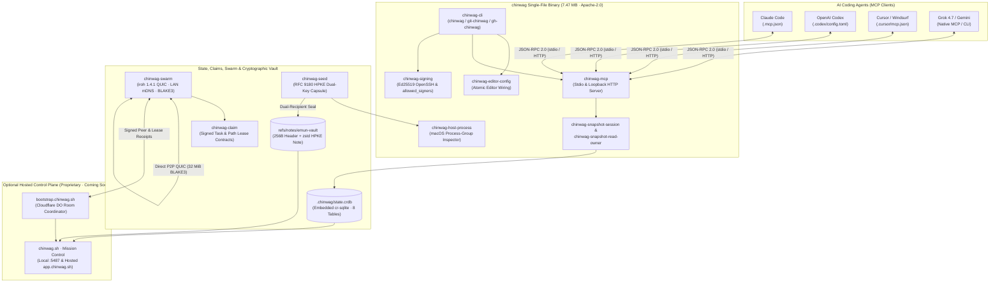

<div align="center">

# `chinwag`

### **Stop Your AI Agents From Stepping on Each Other.**  
#### *Prompts Are Suggestions. Invariants Are Law. Commits Are Evidence.*

[](https://opensource.org/licenses/Apache-2.0)
[](https://www.rust-lang.org)
[](https://modelcontextprotocol.io)
[](https://iroh.computer)
[](https://www.rfc-editor.org/rfc/rfc9180.html)

**Chinwag is the local-first Multi-Agent Swarm Coordination Bus, Atomic Lease Engine, and Cryptographic Flight Recorder built in Rust by Emun Labs.**  
Each AI coding agent gets its own `Ed25519` signing identity, shares one conflict-free local SQLite memory (`.chinwag/state.crdb`), and seals a dual-recipient `RFC 9180` HPKE flight capsule to every Git commit — all in a single `7.47 MB` dependency-free binary under `Apache-2.0`.

[60-Second Quickstart](#-60-second-quickstart) · [The 5 Killer Features](#-the-5-killer-features) · [Architecture & Crate Map](#-architecture--crate-map) · [Open-Core vs. Hosted Relay (Coming Soon)](#-open-core-apache-20-vs-hosted-relay-bootstrapchinwagsh--appchinwagsh--coming-soon) · [Verify Commit #1](#-dont-take-our-word-for-it--verify-the-genesis-commit)

</div>

---

## ⚡ 5 Agents. 1 Repo. Total Chaos. — vs. The Chinwag Way

Every serious engineer today runs more than one AI coding agent on the same repository: you plan architecture in **ChatGPT / Codex**, write backend systems in **Claude Code**, refactor UI in **Cursor**, and run deep reviews in **Grok 4.7** or **Gemini**.

Without a coordination layer, running multiple agents against one codebase breaks in five predictable ways:

| Failure Mode | Running 5 Agents Blindly (Today) | Running on `chinwag` (**The Chinwag Way**) | `v0.1.0` → `v0.1.1` Status |
| :--- | :--- | :--- | :--- |
| **1. Tool Switching & Context Compaction** | **Total Amnesia.** When Claude hits a 5-hour rate limit or compacts context, Codex has zero idea what was just tried or which dead ends (`tombstones`) already failed. | **Switch Agents. Keep the Thread.** Pin decisions, symbols, and dead-end tombstones in `.chinwag/state.crdb` (`chinwag_pin_context` → `chinwag_read_thread`). | ✅ **`v0.1.0-genesis`** (`~2,000 ms` poll; `<15 ms` event wake in `v0.1.1`) |
| **2. Concurrent File Edits** | **Race Conditions & $40 Token Burn.** Two agents overwrite the same file or spend $40 in duplicate API tokens refactoring the same module on different machines. | **Atomic Path Leases (`chinwag-claim`).** Signed task claims, path/symbol globs, and expiring cryptographic leases prevent collisions across editors and Macs. | ✅ **`v0.1.0-genesis`** (`chinwag-claim` + `bootstrap.chinwag.sh` verified) |
| **3. Repo Rules (`CLAUDE.md` / `.cursorrules`)** | **"Prompt Hope."** Static markdown reminders are routinely ignored after 20 minutes of context compaction, shipping non-compliant commits. | **Executable Repo Law (`verified_invariants`).** Rules are pinned to `file_path`, `symbol_hash`, and `source_commit` in `.chinwag/state.crdb` and checked at the commit gate. | 🟢 **Schema + Pins in `v0.1.0`** · Pre-commit gate in `v0.1.1` |
| **4. Git Authorship & Security Audit** | **Zero Accountability.** AI commits are stamped with your personal Git identity or a generic bot token. No record of what prompt or tool receipt produced the diff. | **Dual-Recipient Flight Recorder (`refs/notes/emun-vault`).** Every agent signs commits with its own `Ed25519` key and attaches a `zstd` + `RFC 9180` HPKE encrypted black-box capsule bound to the exact commit SHA. | ✅ **`v0.1.0-genesis`** (Verified across MacBook Pro + Mac Studio) |
| **5. Multi-Machine Plumbing** | **Docker & SaaS Lock-In.** Sharing agent state across a laptop and desktop workstation requires Postgres containers, Python venvs, or sending plaintext code to a cloud middleman. | **Sovereign P2P QUIC (`chinwag-swarm`).** Single `7.47 MB` binary with `iroh 1.4.1` QUIC, `LAN mDNS`, `BLAKE3` verified blobs (up to 32 MiB), and zero third-party `n0` relays. | ✅ **`v0.1.0-genesis`** (LAN mDNS + `bootstrap.chinwag.sh` room verified) |

---

## 🔥 The 5 Killer Features

### Killer Feature #1: Pre-Claim Architectural Invariant Gate (`verified_invariants` + `chinwag-claim`)

> **Why it matters:** Static `.cursorrules` and `CLAUDE.md` files are polite wishes that vanish the moment an agent's context window compacts. Chinwag turns architectural rules, module boundaries, and SPDX license headers into **stateful, commit-anchored invariants** stored in `.chinwag/state.crdb`. Agents must pin and acknowledge active invariants for a file scope before claiming a lease or settling a co-signed commit.

- **Commit-Anchored Rule Pins (`context_pins`):** Anchor architectural decisions and mandatory invariants (such as `spdx-apache-2.0-emun-labs-header-v1`) directly to `file_path`, `symbol_hash`, and `source_commit`.
- **Signed Task & Path Claims (`chinwag-claim`):** Pure `Ed25519`-signed claim requests and coordinator receipts with strict field/path validation (`native` + `WASM`), ensuring no two agents edit the same blast radius concurrently.
- **Invariant Attestation (`verified_invariants`):** Records `(repo_id, branch_ref, source_commit, file_path, invariant, ci_run_id, ci_receipt_hash)` in `.chinwag/state.crdb` so downstream reviewers and `chinwag.sh · Mission Control` have mathematical proof that verification passed.

```json
// MCP Tool Call: chinwag_pin_context — Pin an architectural invariant to a file & commit SHA
{
  "name": "chinwag_pin_context",
  "arguments": {
    "id": "pin-spdx-apache-header-v1",
    "thread_id": "thread-chinwag-core",
    "file_path": "crates/chinwag-swarm/src/lib.rs",
    "symbol_hash": "sha256:9f86d081884c7d659a2feaa0c55ad015a3bf4f1b2b0b822cd15d6c15b0f00a08",
    "source_commit": "8123089ce0a26e94052babb94d946ef14d0ad462",
    "body": "INVARIANT [spdx-apache-2.0-emun-labs-header-v1]: All source files must retain the Emun Labs, Inc. Apache-2.0 header and forbid third-party n0 relays.",
    "created_at_ms": 1793064000000
  }
}
```

---

### Killer Feature #2: Local-First CRDT Context Bus (`.chinwag/state.crdb`) + Zero-Config Multi-Mac P2P Swarm (`chinwag-swarm`)

> **Why it matters:** When you switch from Claude Code on your MacBook Pro to Codex or Grok on your Mac Studio, your agents shouldn't lose their train of thought—and you shouldn't have to spin up Docker or expose plaintext repos to a cloud broker. Chinwag embeds a conflict-free replicated SQLite engine (`cr-sqlite`) and a sovereign `iroh 1.4.1` QUIC transport directly inside the binary.

- **8-Table Embedded `cr-sqlite` Store (`CHWG` Schema v1):** Compiles `threads`, `messages`, `context_pins`, `tombstones` (dead-end approaches so the next agent never repeats a failed experiment), `verified_invariants`, `flight_checkpoints`, `agent_claims`, and `leases` directly into `.chinwag/state.crdb`.
- **Sovereign `iroh 1.4.1` QUIC Transport:** Starts from `iroh`'s `Minimal` preset, binds the exact same OpenSSH `Ed25519` identity used by Git, **strips out all third-party `n0` relays and HTTP Pkarr services**, and enforces `RelayPolicy::Own`.
- **LAN mDNS + `bootstrap.chinwag.sh` Room Discovery:** Automatically discovers peer Macs over local IPv4 interfaces (`mDNS` immune to VPN default-route hijacking) or coordinates across networks via our Rust/WASM Cloudflare Durable Object room coordinator (`bootstrap.chinwag.sh`), streaming gossip (`iroh-gossip`) and `BLAKE3`-verified blobs up to `32 MiB` (`iroh-blobs`).

```sh
# Initialize local Ed25519 signing identity, .chinwag/allowed_signers, and .chinwag/state.crdb
git chinwag init

# Run the two-Mac LAN mDNS / QUIC swarm pair probe across explicit local interfaces
CHINWAG_LAN_IPV4="192.168.1.42" cargo run --package chinwag-swarm --example pair_probe
```

---

### Killer Feature #3: Dual-Recipient `RFC 9180` HPKE Flight Recorder (`refs/notes/emun-vault` / `chinwag-seed`)

> **Why it matters:** *"Every commit keeps its black box."* When 40%+ of your repository is written or reviewed by AI agents, `git blame` is no longer enough to understand what happened or verify provenance. Chinwag seals the prompt summary, tool receipts, peer attestation signatures, and source hashes into a tamper-evident cryptographic capsule attached directly to the Git commit via `refs/notes/emun-vault`.

- **Fixed 256-Byte Header + `zstd` Payload ([`docs/seed-capsule-v1.md`](docs/seed-capsule-v1.md)):** Deterministic binary layout with strict size bounds and zero-copy header inspection.
- **Dual-Recipient `RFC 9180` HPKE (`X25519` + `ChaCha20-Poly1305`):**
  - **Key Slot 1 (Developer / Team Key):** Opened by the developer or engineering team (or published as a public verification key for open-source releases).
  - **Key Slot 2 (Independent Verification Key):** Second independent `RFC 9180` recipient wrap allowing separate verification without sharing the primary developer key.
- **Cryptographic Commit Binding (AAD):** The capsule is mathematically bound to the target Git commit OID. Flip a single byte of the capsule, or move the note to another commit SHA, and decryption immediately refuses to open.

```sh
# Build the standalone capsule inspector and flight-recorder seed
cargo build --bin chinwag-seed --locked

# Verify the Ed25519 co-signed Genesis commit and inspect its attached RFC 9180 HPKE vault note
git verify-commit 8123089ce0a26e94052babb94d946ef14d0ad462
git notes --ref=refs/notes/emun-vault show 8123089ce0a26e94052babb94d946ef14d0ad462 | head -c 256 | xxd
```

---

### Killer Feature #4: Universal MCP Stdio & Loopback Server (`chinwag-mcp` + `chinwag-editor-config`)

> **Why it matters:** *"It speaks MCP, so your agent already knows how to use it."* You don't need to rewrite your workflow or install brittle editor plugins. One command wires Chinwag's shared memory and verification tools directly into your AI coding assistants over bounded, memory-safe Model Context Protocol (`stdio` or authenticated loopback `HTTP`).

- **One-Command Editor Wiring (`chinwag configure-editor`):** Automatically generates repository-scoped MCP configurations with atomic file ownership checks for **Claude Code** (`.mcp.json`), **Codex** (`.codex/config.toml`), and **Cursor** (`.cursor/mcp.json`, with live 4-way **Cursor + Gemini** sub-15ms handoff landing in `v0.1.1`).
- **Context & Handoff Tools (`chinwag-mcp`):** Exposes `chinwag_read_thread`, `chinwag_pin_context`, and `chinwag_handoff` with idempotent replay protection, strict 64 KiB field validation, and zero leaked file descriptors (`RepositoryAdmission` guard).
- **Allowlisted Source Read & Locked Verification (`chinwag-seed` MCP modes):**
  - `serve-read-mcp`: Exposes `read_file` restricted to an operator-supplied exact path allowlist with verified `SHA-256` digests (refusing unauthorized paths like `.grok/session`).
  - `serve-verify-mcp`: Exposes zero-argument `run_cargo_test`, running locked offline `cargo check` + `cargo test` inside an isolated process group monitored by native macOS BSD kernel proc-table inspection (`chinwag-host-process`).

```sh
# Wire Claude Code or OpenAI Codex to the repository's Chinwag MCP server in one command
git chinwag configure-editor --repo "$PWD" --editor claude-code
git chinwag configure-editor --repo "$PWD" --editor codex

# Or launch the repository MCP server directly over stdio (or authenticated loopback HTTP)
git chinwag mcp-serve --repo "$PWD" --transport stdio
```

---

### Killer Feature #5: `chinwag.sh · Mission Control` & Commit-Anchored Wiki (`chinwag wiki-sync`)

> **Why it matters:** Terminal logs aren't enough when you're orchestrating a fleet of autonomous agents across branches and machines. **`chinwag.sh · Mission Control`** (available locally on `:5487` and hosted at `app.chinwag.sh`) gives engineering leads a live visual command center over `.chinwag/state.crdb` and `refs/notes/emun-vault`.

- **Visual Swarm Command Center:** Interactive **Gantt** (critical-path & dependency drawing), **Kanban**, **Calendar**, and **Agents · Swarm Chat** (`■ GEMINI-PM`, `■ ARCHITECT`, `■ RUST`, `■ TYPE`, `■ VENTURE`, `■ MO`, `■ EAGLE-EYE`, `■ DECLARATION`).
- **Commit-Anchored Provenance Wiki (`source_commit === HEAD`):** Every specification and architecture doc carries an anchored `source_commit` header. When code advances ahead of documentation, Mission Control automatically badges stale pages as `DRIFTED FROM HEAD`.
- **Agent Cost & Lease Telemetry (`$ / Verified Commit`):** Tracks input, output, and cached token usage per commit across Claude Code, Codex, Cursor, Gemini, and Grok, and highlights duplicate agent runs prevented by atomic `chinwag-claim` leases.

---

## 🏗️ Architecture & Crate Map

All 12 workspace crates in `emunlabs/chinwag` enforce `#![forbid(unsafe_code)]` across the CLI and MCP layers, deterministic dependency pinning (`Cargo.lock`), `panic = "abort"`, and Rust `1.97.1` (Edition 2024).



### Workspace Crate Inventory (`crates/*`)

| Crate / Component | Path | Target | Role in the Chinwag Architecture |
| :--- | :--- | :--- | :--- |
| **`chinwag-cli`** | [`crates/chinwag-cli`](crates/chinwag-cli) | `bin: chinwag` | Main user-facing CLI & Git/GitHub plugin dispatcher (`chinwag`, `git-chinwag`, `gh-chinwag`, `git-emun`, `gh-emun`) for `init`, `mcp-serve`, and `configure-editor`. |
| **`chinwag-mcp`** | [`crates/chinwag-mcp`](crates/chinwag-mcp) | `lib` | Bounded MCP server (`rmcp 3.7.0`) over `stdio` and authenticated loopback `HTTP`, serving `chinwag_read_thread`, `chinwag_pin_context`, and `chinwag_handoff`. |
| **`chinwag-swarm`** | [`crates/chinwag-swarm`](crates/chinwag-swarm) | `lib` | Sovereign P2P transport built on `iroh 1.4.1` QUIC, `iroh-gossip`, `iroh-blobs` (`BLAKE3` 32 MiB cap), VPN-safe `LAN mDNS`, and `bootstrap.chinwag.sh` room client. |
| **`chinwag-claim`** | [`crates/chinwag-claim`](crates/chinwag-claim) | `lib` (`native` + `wasm`) | Pure `Ed25519`-signed task-claim requests, coordinator receipts, and strict PR/file glob policy checks shared between the CLI and Cloudflare Durable Objects. |
| **`chinwag-seed`** | [`crates/chinwag-seed`](crates/chinwag-seed) | `bin` + `lib` | `RFC 9180` HPKE (`X25519` + `ChaCha20-Poly1305` + `zstd`) 256-byte header flight-recorder capsule library, inspector, `serve-read-mcp`, and `serve-verify-mcp`. |
| **`chinwag-signing`** | [`crates/chinwag-signing`](crates/chinwag-signing) | `lib` | OpenSSH `Ed25519` key generation, identity binding, email-privacy enforcement, and repository-scoped `.chinwag/allowed_signers` management. |
| **`chinwag-editor-config`** | [`crates/chinwag-editor-config`](crates/chinwag-editor-config) | `lib` | Atomic, symlink-safe generator for `.mcp.json` (Claude Code), `.codex/config.toml` (Codex), and `.cursor/mcp.json` (Cursor). |
| **`chinwag-host-process`** | [`crates/chinwag-host-process`](crates/chinwag-host-process) | `lib` (`macOS`) | Native BSD kernel process-group snapshot inspector (`libc` + `bindgen`) guaranteeing zero orphaned child processes after `run_cargo_test` timeouts or cancellations. |
| **`chinwag-snapshot-session`** | [`crates/chinwag-snapshot-session`](crates/chinwag-snapshot-session) | `lib` | Statically embedded SQLite + `cr-sqlite` (`CHWG` Schema v1) transactional session engine owning the 8 coordination tables in `.chinwag/state.crdb`. |
| **`chinwag-snapshot-read-owner`** | [`crates/chinwag-snapshot-read-owner`](crates/chinwag-snapshot-read-owner) | `lib` | Capability-oriented directory descriptor admission guard (`rustix` `openat`/`fstat`) preventing TOCTOU symlink swaps on `.git` and `.chinwag`. |
| **`confirmed-initial`** | [`crates/confirmed-initial`](crates/confirmed-initial) | `lib` | Atomic repository initialization coordinator uniting key generation, Git config, and initial `.chinwag/state.crdb` store creation with rollback safety. |
| **`confirmed-initial-consumer`** | [`crates/confirmed-initial-consumer`](crates/confirmed-initial-consumer) | `lib` | Integration verification consumer validating end-to-end initialized store invariants and signing readiness. |
| **`.chinwag/state.crdb`** | Repository `.chinwag/` | `cr-sqlite` WAL | Local conflict-free state bus (`threads`, `messages`, `context_pins`, `tombstones`, `verified_invariants`, `flight_checkpoints`, `agent_claims`, `leases`). |
| **`chinwag.sh · Mission Control`** | Companion / `app.chinwag.sh` | Node 26 + SQLite | Visual Gantt, Kanban, Calendar, Agent Swarm Chat, Commit-Anchored Provenance Wiki, and Agent Token & Lease Telemetry (`:5487`). |

---

## 🚀 60-Second Quickstart

### 1. Install or Build `chinwag`

```sh
# Option A: Install via Homebrew (macOS Apple Silicon)
brew install emunlabs/tap/chinwag

# Option B: Build from verified source (requires Rust 1.97.1)
git clone https://github.com/emunlabs/chinwag.git
cd chinwag
cargo build --release --bin chinwag --locked
```

### 2. Initialize Your Repository & Wire Your AI Editors

Run `chinwag init` inside any Git repository to provision your repository-scoped `Ed25519` signing identity, `.chinwag/allowed_signers`, and `.chinwag/state.crdb` CRDT context store:

```sh
# Initialize .chinwag/state.crdb and repository-scoped Ed25519 Git commit signing
./target/release/chinwag init

# Wire Claude Code (.mcp.json) and OpenAI Codex (.codex/config.toml)
./target/release/chinwag configure-editor --repo "$PWD" --editor claude-code
./target/release/chinwag configure-editor --repo "$PWD" --editor codex
```

### 3. Run the Full Workspace Verification Suite

Every crate, cryptographic vector, MCP stdio/HTTP lifecycle, and process-group cleanup invariant can be verified offline with zero external network dependencies:

```sh
cargo test --workspace --locked
cargo fmt --all -- --check
cargo clippy --workspace --all-targets --locked -- -D warnings
cargo build --bin chinwag --locked
cargo build --bin chinwag-seed --locked
```

---

## 🔬 Don't Take Our Word for It — Verify the Genesis Commit

`chinwag v0.1.0-genesis` wasn't typed by humans in VS Code. Over 72 hours and 381+ autonomous turns between a MacBook Pro (`AXEL` / ChatGPT Conductor) and a Mac Studio (`RANDO` / Grok 4.7 `xhigh`), two agents wrote and peer-reviewed all 235 source files, attested the final tree over `iroh` QUIC, co-signed Commit #1 (`8123089ce0a26e94052babb94d946ef14d0ad462`), and sealed its flight record in `refs/notes/emun-vault` (`8398cdd`).

Verify the cryptographic chain on your own machine right now:

```sh
# 1. Verify the Ed25519 Git signature on Commit #1 against .chinwag/allowed_signers
git config gpg.ssh.allowedSignersFile .chinwag/allowed_signers
git verify-commit v0.1.0-genesis

# 2. Inspect the sealed RFC 9180 HPKE capsule attached in refs/notes/emun-vault
git notes --ref=refs/notes/emun-vault show v0.1.0-genesis | shasum -a 256
```

---

## 💎 Open-Core (`Apache-2.0`) vs. Hosted Relay (`bootstrap.chinwag.sh` / `app.chinwag.sh` — Coming Soon!)

> **Our Open-Core Principle:** *The CLI does the work. The hosted relay keeps it running when you're not there.*  
> The `chinwag` CLI, all 12 Rust crates, local `.chinwag/state.crdb`, `LAN mDNS` swarm discovery, `Ed25519` commit signing, and local `RFC 9180` HPKE flight capsules are **free forever under the Apache-2.0 license** and work completely offline without an account. We will never move a shipped open-source feature behind a paywall.

> [!NOTE]
> **Availability Status:** **Community (`Apache-2.0` Open Core)** is **Live Today (`v0.1.0-genesis`)**. Self-serve **Hosted Relay & Cloud Control Plane (`bootstrap.chinwag.sh` / `app.chinwag.sh`)** is **Coming Soon!** (currently running in private two-Mac dogfooding).

When you need an **always-on coordinator across networks** or **team-wide atomic lease enforcement**, connect your CLI to **`bootstrap.chinwag.sh`** and **`app.chinwag.sh`**:

| Tier | Status | Who It's For | **The Killer Feature** | What's Included |
| :--- | :--- | :--- | :--- | :--- |
| **Community (Open Core — `Apache-2.0`)** | ✅ **Live Now** *(`v0.1.0-genesis`)* | Individual multi-model devs on 1 Mac or same-room LAN (`mDNS`) | **"Zero-Collision Local Shared Brain (`state.crdb`)."** Up to 10 local agents share context pins, dead-end `tombstones`, and local file claims with zero cloud account required. | Full `chinwag` binary, local `.chinwag/state.crdb`, `Ed25519` Git commit signing, `LAN mDNS` discovery, local `refs/notes/emun-vault` capsules, self-hosted `RelayPolicy::Own` support. |
| **Pro Hosted Relay (`bootstrap.chinwag.sh`)** | 🚧 **Coming Soon** | Power developers running 2+ Macs (MacBook Pro + Mac Studio) & cloud VMs | **"Your Macs Stay Connected When the Lid Closes."** One `chinwag login` connects your laptop, desktop Studio, and cloud devboxes across any firewall/NAT with zero DevOps. | Hosted `bootstrap.chinwag.sh` Durable Object room coordinator, managed `RelayPolicy::Own` NAT traversal relay, personal `app.chinwag.sh` Mission Control view. |
| **Team Swarm Cloud (`app.chinwag.sh`)** | 🚧 **Coming Soon** | AI-native engineering teams + autonomous agent fleets | **"One Lease Authority for the Whole Team."** Stops two teammates' agents from burning API tokens on the same file/symbol across branches, and tracks duplicate runs avoided in `app.chinwag.sh`. | Shared organization rooms on `bootstrap.chinwag.sh`, team-wide atomic `chinwag-claim` leases & `verified_invariants`, Hosted Mission Control (`app.chinwag.sh`) with per-commit token telemetry. |

---

## 🏛️ Corporate Provenance & License

- **Maintainer:** **Emun Labs, Inc.** · `1401 Lavaca St STE 81335, Austin, TX 78701`
- **Open-Source License:** Licensed under the **Apache License, Version 2.0** (`SPDX-License-Identifier: Apache-2.0`). See [`LICENSE`](LICENSE) for full terms.
- **Hosted Coordinator & Trademarks:** Server-side coordinator infrastructure (`bootstrap.chinwag.sh`, `app.chinwag.sh`) resides in the separate private `emunlabs/emun-enterprise-cloud` repository. `Chinwag`, `chinwag.sh`, and `Emun Labs` are trademarks of Emun Labs, Inc.
