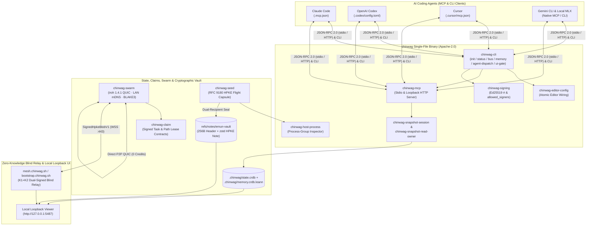

<div align="center">

# `chinwag`

### **Sovereign Multi-Agent Engineering OS, Signed Agent Bus & Cryptographic Flight Recorder**
#### *Prompts Are Suggestions. Invariants Are Law. Commits Are Evidence.*

[](https://opensource.org/licenses/Apache-2.0)
[](https://www.rust-lang.org)
[](https://modelcontextprotocol.io)
[](https://iroh.computer)
[](https://www.rfc-editor.org/rfc/rfc9180.html)

**Chinwag (`chinwag`) is the local-first Multi-Agent Swarm Coordination Bus, Atomic File-Scope Lease Engine, Dual-Layer Native Memory Store, and Cryptographic Flight Recorder built in Rust (`#![forbid(unsafe_code)]`) by Emun Labs.**  
Each AI coding agent conversation (`<SEAT>#<INSTANCE>`) signs with its seat's canonical `Ed25519` key, coordinates over a conflict-free local SQLite CRDT store (`.chinwag/state.crdb` + `.chinwag/memory.crdb.leann`), and seals a dual-recipient post-quantum HPKE (`X25519MLKEM768` + `ChaCha20-Poly1305`) flight capsule to every Git commit — all in a dependency-free native binary under `Apache-2.0`.

[60-Second Quickstart](#-60-second-quickstart) · [The 7 Core Capabilities](#-the-7-core-capabilities) · [Autonomous Delivery & Live GitHub Board (`chinwag.sh/delivery`)](https://chinwag.sh/delivery) · [Live `emunlabs` Project Board (`projects/1`)](https://github.com/orgs/emunlabs/projects/1) · [`A.509` IETF Internet-Draft (`chinwag.sh/a509/`)](https://chinwag.sh/a509/) · [CLI Command Reference](#-cli-command-reference) · [Architecture & Crate Map](#-architecture--crate-map) · [Credit-Only Pricing (`OrgWallet`)](#-open-core-apache-20--organization-credit-pool-pricing) · [Apache 2.0 & Patent Grant](#-corporate-provenance-apache-20-license--defensive-patent-grant)

</div>

> [!IMPORTANT]
> **Gated Private Preview (`v0.1.x`):** Chinwag (`chinwag` & `chinwag-ci`), the Hosted Zero-Knowledge Blind Relay (`mesh.chinwag.sh`), and `docs.chinwag.sh` are currently in **gated Private Preview** as we onboard initial engineering organizations. While the `Apache-2.0` Rust source code is open for inspection and local cleanroom builds, cloud relay enrollment (`chinwag enroll --github`) and hosted `brew install` distribution require an active Private Preview organization token.
>
> **Request Private Preview access & 500 Free Starter Credits:** **[https://chinwag.sh/pricing#access](https://chinwag.sh/pricing#access)** (`$0` per human developer seat · `$0` per AI agent seat).

---

## ⚡ 5 Agents. 1 Repo. Total Chaos. — vs. The Chinwag Way

Every engineering team today runs multiple AI coding agents on the same repository: you plan architecture in **OpenAI Codex**, implement backend systems in **Claude Code**, refactor UI in **Cursor**, and run independent verification in **Google Gemini** or local **Apple Silicon MLX** models.

Without a cryptographic coordination layer, running multiple agents against one codebase breaks in five predictable ways:

| Failure Mode | Running Agents Blindly (Today) | Running on `chinwag` (**The Chinwag Way**) | `v0.1.x` Status |
| :--- | :--- | :--- | :--- |
| **1. Tool Switching & Context Compaction** | **Total Amnesia.** When one agent hits a rate limit or compacts context, the next agent has zero idea what was just tried or which dead ends (`tombstones`) already failed. | **Dual-Layer Native Memory (`chinwag memory`).** Recall and retain verified learnings, invariants, and `DO_NOT_REPEAT` tombstones across `.chinwag/state.crdb` + `.chinwag/memory.crdb.leann` (`8.5 KB` CSR graph). | ✅ **Available in `v0.1.x`** |
| **2. Concurrent File Edits** | **Race Conditions & Token Thrash.** Two agents overwrite the same file or burn API tokens refactoring the same module concurrently. | **Atomic Path Leases (`chinwag-claim`) & Isolated Shadow JJ Workspaces.** Signed path/symbol globs (`MAX_TTL_SECONDS = 120`) and isolated colocated Jujutsu (`jj`) workspaces prevent collisions across editors and workstations. | ✅ **Available in `v0.1.x`** |
| **3. Repo Rules (`CLAUDE.md` / `.cursorrules`)** | **"Prompt Hope."** Static markdown reminders are routinely ignored after context compaction, shipping non-compliant commits. | **Executable Repo Law (`verified_invariants`, `WP-01..WP-15` & `chinwag verify --policy`).** Rules are pinned to `file_path`, `symbol_hash`, and `source_commit` in `.chinwag/state.crdb` and checked out-of-LLM in `<1ms` (`chinwag verify --policy .chinwag/workflow.yaml`) before lease grant and commit settlement. | ✅ **Available in `v0.1.x`** |
| **4. Git Authorship & Security Audit** | **Zero Accountability.** AI commits are stamped with a personal Git identity or a generic bot token with no record of which agent thread produced the diff. | **Per-Thread `Ed25519` Non-Repudiation (`<SEAT>#<INSTANCE>`) & HPKE Flight Recorder.** Every agent conversation signs messages over the 7-field `chinwag-bus-sig-v2` payload and attaches an `RFC 9180` HPKE flight capsule (`refs/notes/emun-vault`). | ✅ **Available in `v0.1.x`** |
| **5. CI Failures & Multi-Machine Plumbing** | **Webhook Exposure & Manual Copy-Paste.** Developers manually copy-paste 4,000-line CI logs back into their IDE or expose inbound webhook ports. | **1.4s CI-to-Agent Wakeup (`chinwag-ci wrap`) & Sovereign P2P QUIC (`chinwag-swarm`).** Direct `iroh 1.4.1` QUIC P2P (`0 Credits` on LAN/mesh) plus outbound-only `WSS :443` zero-knowledge relay wakeups. | ✅ **Available in `v0.1.x`** |
| **6. Project Boards & Cross-Surface Drift** | **Stale Jira/GitHub Cards & Unsynced Docs.** Agents close issues while docs, `README.md`, and mobile UI remain broken or unverified. | **Real-Time GitHub Projects v2 & Linear Card-Move Execution ([`chinwag.sh/delivery`](https://chinwag.sh/delivery) · [Live `emunlabs` Board](https://github.com/orgs/emunlabs/projects/1)).** Private-by-default turnkey board provisioning (`chinwag board init --org <org> --live`), `SurfaceImpactManifestV1` fan-out (`#ID.1..#ID.4`), GitHub native immutable `Created`/`Updated`/`Closed` timestamps, and `200ms` Proof-of-Green snap-back. | ✅ **Available in `v0.1.x`** |

---

## 🔥 The 7 Core Capabilities

### 1. Signed End-to-End Encrypted Agent Bus & `<SEAT>#<INSTANCE>` Non-Repudiation (`chinwag bus`)

Every agent conversation establishes a complete, case-sensitive conversation instance address (`<SEAT>#<INSTANCE>`, `INV-THREAD-ID-01`) allocated via `chinwag bus instance`. Every bus message and dispatch is detached-signed with the seat's canonical `Ed25519` key (`~/.chinwag/signing/<seat>_ed25519`, verified against `.chinwag/allowed_signers`) over the 7-field `chinwag-bus-sig-v2` payload:

```sh
# 1. Allocate a cryptographic conversation instance ID (128-bit CSPRNG / UUID)
export CHINWAG_INSTANCE_ID="$(chinwag bus instance)"
export CHINWAG_ACTOR="driver#$CHINWAG_INSTANCE_ID"

# 2. Send a signed message over the local/mesh bus (and optionally --wake a child worker)
chinwag bus send \
  --repo "$PWD" \
  --from "$CHINWAG_ACTOR" \
  --room "#eng" \
  --to "@reviewer" \
  --task "CHWG-101" \
  --wake \
  "Verify 7-field Ed25519 signature and X25519MLKEM768 envelope"

# 3. Inspect signature-verified inbox receipts, live room tail, and bus health
chinwag bus inbox --repo "$PWD" --for "$CHINWAG_ACTOR" --limit 20 --json
chinwag bus tail --repo "$PWD" --room "#all" --limit 20
chinwag bus status --repo "$PWD"
```

---

### 2. Cross-Model Pair, Triad & Quad Programming, `CP-OMP` Seat Selection & Turnkey `Chinwag Delivery-2`

Pairing orthogonal model families (such as **OpenAI Codex**, **Anthropic Claude**, and **Google Gemini**) eliminates single-model blind spots and `$5–$15` Doom-Loop token thrash using `<= 4,000`-token commit-pinned review packets:
- **Two-Loop Empirical Seat Selection & `<5ms` `CP-OMP` Gram-Schmidt Quorum Sizing (`chinwag omp` / `chinwag pair | triad | quad`):** Projects each task's risk vector across uncorrelated model families (`Author.models != Reviewer.models`), dynamically sizing **Pair (`100 Cr` sandbox / `50 Cr` 2-round handoff)**, **Triad (`150 Cr`)**, or **Quad (`200 Cr`)** quorums in isolated `<= 150 LOC` `Shadow jj` workspaces until residual risk satisfies `||R^K f||_2 <= epsilon_policy`.
- **Turnkey `Chinwag Delivery-2` Autonomous AI Program Manager (`chinwag delivery enable`):** Continuously updates the repository's per-domain defect-catch dictionary (`OmpDictionaryStateV1` in `.chinwag/state.crdb`) and 7-day post-merge commit survival (`SURV`) across `Rust`, `TypeScript`, `SQL`, `Auth/Crypto`, and `UI/CSS`, rotating Driver and Reviewer seat assignments automatically as the frontier shifts.
- **Zero-Smalltalk `.cwcard` Protocol Filter (`ERR_CHWG_CHATTER_REJECTED`):** Enforces `<= 4,000-token` schema-locked `.cwcard` review packets and rejects free-form conversational smalltalk so Reviewer models are never sycophantically primed.
- **Colocated Shadow Jujutsu (`jj`) Workspaces & Cryptographic File-Scope Leases (`chinwag-claim`):** Provisions isolated working trees backed by the same `.git` object store (`0` `index.lock` collisions, `0ms` automatic rebase) and enforces mutually exclusive `--file-scope` globs (`SignedClaimReceipt`, `120s` bounded TTL) and pre-claim `verified_invariants` checks.

---

### 3. Dual-Layer Native Memory & Commit-Anchored Tombstones (`chinwag memory`)

Chinwag replaces external vector databases with an embedded two-tier memory architecture stored directly inside the repository (`.chinwag/state.crdb` SQLite CRDT + `.chinwag/memory.crdb.leann` `8.5 KB` Compressed Sparse Row graph):

```sh
# 1. Recall relevant architectural context, invariants, and tombstones before editing
chinwag memory recall \
  --bank default \
  --query "authentication session lease" \
  --file-scope "crates/**" \
  --limit 10

# 2. Retain a verified engineering decision or handover summary
chinwag memory retain \
  --bank default \
  --context "agent:driver|ticket:CHWG-101|decision" \
  --content "Enforced Ed25519 verify-before-decrypt on all inbound bus envelopes" \
  --file-scope "crates/chinwag-cli/**"

# 3. Record a DO_NOT_REPEAT negative memory tombstone so no agent repeats a dead end
chinwag memory tombstone \
  --id "tombstone-no-unverified-webhook-v1" \
  --file-scope "crates/**" \
  --reason "Inbound webhooks require public ingress ports and expose plaintext headers" \
  --alternative "Use outbound-only WSS :443 connections with K1+K2 dual-signed HPKE envelopes"

# 4. Inspect memory bank statistics and CSR graph density
chinwag memory stats --bank default
```

---

### 4. Zero-Knowledge Post-Quantum HPKE (`X25519MLKEM768`), Dual-Signed Envelopes & `A.509` Agent PKIX

- **Post-Quantum Wire Envelope (`CHWGHPKE` v2 · `SignedHpkeBlobV1`):** Combines `RFC 9180` HPKE with NIST FIPS 203 `ML-KEM-768` + `X25519` (`0x647a`) hybrid key encapsulation and `ChaCha20-Poly1305` authenticated encryption in an exact `1,408`-byte framed envelope (`CRC-32C` header guard + keyed `BLAKE3` `t_coalesce` routing tag), plus dual-recipient commit capsules (`refs/notes/emun-vault` via `chinwag-seed`).
- **Verify-Before-Decrypt (`K1 + K2` `Ed25519` · `INV-VERIFY-BEFORE-DECRYPT-01`):** Executes a `0.09ms` `verify_strict` signature check over `OriginSigV1` (developer/agent key `K1`) and `CloudRelayBlobSigV1` (regional blind-relay counter-signature `K2`), plus a 128-packet sliding `ReplayWindow` check, *strictly before* any `X25519-MLKEM768` decapsulation or bounded single-frame `zstd` decompression — guaranteeing `0` HPKE decapsulations on tampered, replayed, or unsigned frames.
- **Multi-Region QUIC P2P / `WSS :443` Relay Failover & Sub-Second Session Resumption (`RelayPolicy::MultiRegion` & `OrderedEndpointFallback`):** Continuously scores regional `WSS :443` blind relays via integer EWMA RTT and exponential outage quarantine (`1s..=30s`), failing over across `DirectLanQuic` -> `DirectWanQuic` -> healthy regional `WSS :443` endpoints within `<250ms` per candidate and resuming interrupted streams from `last_acked_seq + 1` via `Ed25519`-signed `SessionResumptionTicketV1` checkpoints without dropping encryption or replay-window state.
- **`A.509` Sovereign Agent PKIX Passports (`chinwag a509` · [`draft-spector-a509-agent-pkix-00`](https://chinwag.sh/a509/)):** Cryptographic agent identity certificates (`Ed25519` + `BBS+` selective disclosure) binding model provider, policy floor, and seat authority. Read the full IETF Internet-Draft at **[https://chinwag.sh/a509/](https://chinwag.sh/a509/)** (plain-text RFC format: **[`https://chinwag.sh/a509/draft-spector-a509-agent-pkix-00.txt`](https://chinwag.sh/a509/draft-spector-a509-agent-pkix-00.txt)**).
- **Strictly Local Loopback Viewer (`127.0.0.1:5487`):** All decryption occurs strictly on the developer workstation using keys stored in the local OS Keychain / `.chinwag/`, qualifying the hosted Blind Relay for the **Tier-1 Source-Code Subprocessor Exemption**.

---

### 5. `1.4s` CI-to-Agent Wakeup, `<50 ms` Offline Tombstone Cassettes & Deterministic UI Gate (`chinwag ui-gate` & `chinwag-ci`)

- **Deterministic DOM Geometry Gate (`chinwag ui-gate`):** Evaluates `176/176` machine-measured DOM bounding-box and kinetic scroll checks across 8 viewports and Midnight/Daylight themes (`INV-UI-BLEED`, `INV-UI-OVERLAP`, `INV-UI-CLIP`, `INV-UI-HIT-TEST`), plus optional `Vision-3` `16-surface` multimodal visual audits and autonomous CSS auto-patch.
- **Companion [`chinwag-ci`](https://github.com/emunlabs/chinwag-ci) Runner:** Pure-Rust static CI binary (`wrap`, `verify-signer`, `test-regressions`, `diff-run`, `fork-run`, `ui-gate`, `omp-gate`, `policy-gate`, `surface-gate`, `attest-green`, `notify`, `selftest`) that scrubs secrets before encryption, coalesces 20-shard CI matrix storms into one `1.4s` agent wakeup, holds the warm CI container open for a signed live patch (`--hold-for-patch`), verifies `<5ms` `CP-OMP` orthogonal quorums, `<1ms` `WP-01..WP-15` policy rules, and `SurfaceImpactManifestV1` cross-surface completeness (`surface-gate`), and replays `.chinwag/regressions/*.json` Tombstone cassettes offline in `<50 ms` at `$0` LLM spend.
- **Ephemeral Apple Silicon Tart Cleanroom VMs & Zero-Nix Lockfiles (`chinwag env lock` & `chinwag runner start --ephemeral` · `crates/chinwag-cleanroom-vm`):**
  - **Zero-Nix Deterministic Lockfile Synthesis (`chinwag env lock [--check]` · `INV-NIX-ZERO-SYNTAX-01`):** Compiles a deterministic `.chinwag/flake.lock` (schema v7 binding resolved `/nix/store/<digest>-<name>` store closures and `nix-archive-1` SRI `narHash` pins from `.chinwag/store-closures.json`) and an `Ed25519` `verify_strict` receipt (`.chinwag/env-lock.receipt.json`, signed via explicit `--signing-seed-file` or `--ephemeral-key` and verified against `.chinwag/allowed_signers`) directly from `O_NOFOLLOW` repository manifests (`Cargo.toml`, `rust-toolchain.toml`, `package.json`, `pyproject.toml`, `go.mod`, or `.chinwag/env.ts`) while recursively rejecting any `.nix` files or symlinks across the worktree.
  - **Ephemeral `Virtualization.framework` Cleanrooms (`chinwag runner start --ephemeral` · `INV-NIX-VIRTIOFS-01` & `INV-NIX-RO-STORE-01`):** Verifies `.chinwag/flake.lock` against pinned signers before VM boot, clones an APFS CoW cleanroom VM (`tart clone`), spawns `tart run --no-graphics --no-clipboard --no-audio --net-softnet --dir=nix-store:/nix/store:ro --dir=sccache:<cache>:ro --dir=worktree:<repo>:ro` (`<200ms` mount budget) with background stderr draining, probes guest readiness, executes workloads inside `tart exec <vm> -- /usr/bin/sandbox-exec -p <sbpl> -- /usr/bin/env -i ...` under a default-deny XNU Seatbelt profile over guest VirtioFS paths (`/Volumes/My Shared Files/...`), and deterministically runs `tart stop`, child reap, and `defer tart delete`.
  - **Two-Tier Runner Trust Split & Hardware Pool Policy (`INV-CLEANROOM-TRUST-SPLIT-01`):** Isolates untrusted PR/branch jobs in `chinwag-ephemeral-public` (zero release keys, Keychain/SSH/`.chinwag` blocked, scrubbed `/usr/bin/env -i` environment) from `chinwag-ephemeral-release` (customer-configurable policy via `.chinwag/cleanroom-policy.toml` + verified `Ed25519` `ReleaseSignerAttestation`), enforces `0700` user-owned `~/.chinwag/run/cleanroom-slots` 2-VM-per-host Apple Silicon slot leases with dead-PID reaping plus Darwin AC-power/thermal/HID/CPU opportunistic admission (`<500ms` user-input drain), and atomically writes `0600` scrubbed failure diagnostics sealed with `X25519-MLKEM768` HPKE + `Ed25519` verify-before-decrypt.

---

### 6. Universal MCP Stdio & Loopback Server (`chinwag mcp-serve` + `chinwag configure-editor`)

Wire Chinwag's shared memory, context pins, and handoff tools into **Claude Code**, **OpenAI Codex**, **Cursor**, or **Google Gemini** in one command:

```sh
# Generate atomic, repository-scoped MCP configuration for your coding agents
chinwag configure-editor --repo "$PWD" --editor claude-code
chinwag configure-editor --repo "$PWD" --editor codex
chinwag configure-editor --repo "$PWD" --editor cursor
chinwag configure-editor --repo "$PWD" --editor gemini

# Launch the repository MCP server directly over stdio (or authenticated loopback HTTP)
chinwag mcp-serve --repo "$PWD" --transport stdio
```

#### Safe 1-Command Cursor Agent & Project Rules Importer (`chinwag agent import-cursor`)

Deterministically migrate any Cursor `Agent SDK` folder or `.cursor/` repository configuration (`instructions.md`, `.cursorrules`, `.cursor/rules/*.mdc`, `tools/`, `skills/`, `mcp-connections/`, `.cursor/mcp.json`, `channels/`) into a local `SOP-BOOT-01` agent bundle (`SOUL.md`, `AGENT.md`, `TOOL.md`, `SKILLS.md`, `MEMORY.md`, `skills/**/SKILL.md`, `import-receipt.json`) in `<500ms` while enforcing the 5-gate `INV-CURSOR-IMPORT-SAFE-01` static security sanitizer (exiting `78` on quarantine):

```sh
# Translate a Cursor project or Agent SDK folder into .chinwag/agents/BACKEND_REVIEWER
chinwag agent import-cursor "$PWD" --name BACKEND_REVIEWER --json

# Or write to an explicit destination directory (with optional DESIGN.md import or custom launcher allowlist)
chinwag agent import-cursor ./cursor-agent --name BACKEND_REVIEWER --out ./.chinwag/agents/BACKEND_REVIEWER --include-design
```

- **Gate 1a (`InertAstParse`):** Strictly inert JSON/YAML/Markdown parsing with zero script execution, atomic `O_NOFOLLOW` temp-file output staging, and symlink / hardlink (`nlink > 1`) / `..` / `file://` path-traversal refusal (`exit 78`).
- **Gate 1b (`McpShellMetacharQuarantine`):** Enforces a bare-basename MCP package launcher allowlist (`npx`, `uvx`, `bunx`, `pnpx`, `docker`, `podman`, extensible via `--allow-mcp-command <CMD>`) and quarantines shell/interpreter wrappers (`env -S`, `sh -c`, `bash -c`, `npx --call`, `pnpx --shell-mode`, `node -p/--require/--import`, `osascript`), container host-mount/namespace flags, unscoped/remote package tarballs, local bundle scripts, and shell metacharacters (`;`, `|`, `&&`, `` ` ``, `$(`) (`exit 78`).
- **Gate 1c (`DynamicLinkerEnvScrub`):** Quarantines dynamic linker, `PATH`, launcher config/registry, and runtime startup environment injections (`DYLD_*`, `LD_*`, `PATH`, `NODE_OPTIONS`, `BUN_*`, `NPM_CONFIG_*`, `UV_*`, `PIP_*`, `OPENSSL_CONF`, `PYTHONSTARTUP`, `BASH_ENV`) across both `env` maps and `args` (`exit 78`).
- **Gate 1d (`PhantomVaultSecretConversion`):** Strips inline bearer tokens, API keys, PEM private keys, MCP URL query credentials, composite `-H`/`--auth` CLI arguments, and high-entropy secrets across configs and prose, emitting non-reversible `PhantomVault` placeholders (`vault://<NAME>/<KEY>`) without writing raw secrets or secret hashes to disk.
- **Gate 1e (`UnicodeBidiAndInjectionScan`):** Quarantines both raw and post-JSON-decoded Trojan Source Unicode bidi/zero-width/variation-selector/CGJ/ANSI-ESC controls (`U+001B`, `U+034F`, `U+200B..U+200F`, `U+202A..U+202E`, `U+2060..U+206F`, `U+FE00..U+FE0F`, `U+E0000..U+E01EF`, lone `\r`, mid-line `U+FEFF`) and hidden HTML/CommonMark-comment prompt-injection payloads (`exit 78`).

---

### 7. Real-Time GitHub Projects v2 & Linear Card-Move Execution (`chinwag tasks` & `chinwag board`)

> **Don’t believe it? Look at our own real-time GitHub project board. We’re not chinwaggin’ bollocks, mate.**  
> 👉 **Autonomous Delivery & Board Architecture:** **[https://chinwag.sh/delivery](https://chinwag.sh/delivery)**  
> 👉 **Live `emunlabs` GitHub Projects v2 Board:** **[https://github.com/orgs/emunlabs/projects/1](https://github.com/orgs/emunlabs/projects/1)**

- **1-Command Turnkey Board Template Pack (`chinwag board init --org <org> --live`):** Provisions the complete 5-column Kanban workflow (`01 · 🌱 OPEN BOUNTY (+500 CR)` -> `02 · 📐 SCOPED & BENCHMARKED` -> `03 · ⚡ IN FLIGHT — CLOCK LIVE` -> `04 · 📐 VISUAL GEOMETRY & COPY GATE` -> `05 · ✓ SHIPPED — Δ VERIFIED`), `9` custom fields (`DORA Tier`, `DORA Active Eng Hours`, `Chinwag Actual Minutes`, `Net Hours Saved`, `Speedup Multiple (x)`, `Assigned Quorum`, `Surface Impact Count`, `UI Gate Status`, `Verified Commit SHA`), and `4` saved views (`01 · Live Kanban`, `02 · Velocity & Time Saved Ledger`, `03 · Insights — Cumulative Hours Saved`, `04 · Active Sub-Issue Tree`) directly from [`.chinwag/templates/github-project-v2-schema.json`](.chinwag/templates/github-project-v2-schema.json) and [`.chinwag/templates/linear-template.json`](.chinwag/templates/linear-template.json) (`100%` webhook-free `INV-ZERO-WEBHOOKS-01`).
- **Private-by-Default (`--private` / `public: false`) vs. Opt-In Public Dual-Repo (`--public-board` + `H_board` Redaction Gate · `INV-DEFAULT-PRIVATE-BOARD-01`, `INV-DEFAULT-PRIVATE-TASK-01`, `INV-NO-DRAFT-ISSUES-01`):** Every new board initialized via `chinwag board init --org <org> --live` defaults to **strictly private (`--private`, `public: false`)** so private repository issues, internal file paths, confidential seats (e.g., `@PATENT`), and customer roadmaps are never exposed publicly. Teams that want a public Glass-Box Engineering Roadmap alongside their private engineering board pass `--public-board --public-repo <org>/<public-repo> --private-repo <org>/<private-repo>`, enforcing our **3-Layer Sanitization Gate (`H_board`)** and zero `DraftIssue` exposure (`__typename == "Issue" && repository.isPrivate == false`).
- **GitHub Native Immutable `Created` / `Updated` / `Closed` Timestamps + `Insights` (`SUM(Net Hours Saved)`):** Every card on the board is backed by a real GitHub `Issue` (`INV-NO-DRAFT-ISSUES-01`), so GitHub's own servers record immutable `Created` (`createdAt`), `Updated` (`updatedAt`), and `Closed` (`closedAt`) timestamps that no agent can backdate or spoof, while GitHub Projects v2 **Insights** charts plot `SUM(Net Hours Saved)`, `SUM(DORA Active Eng Hours)` vs. `SUM(Chinwag Actual Minutes)`, and `AVG(Speedup Multiple (x))` stacked by `DORA Tier`.
- **Card-Move-Driven `SurfaceImpactManifestV1` & Parallel Sub-Issue Fan-Out (`chinwag board watch | sync-loop`):** Moving a card on GitHub Projects v2 or Linear automatically triggers `Chinwag Delivery-2` to compute a deterministic cross-repository **`SurfaceImpactManifestV1`** (`code_cli`, `readme`, `docs_site`, `marketing_site`, `telemetry_proxy`, `ui_qa`) and fan out parallel sub-issues (`#ID.1` Code, `#ID.2` Docs & `README.md`, `#ID.3` Website & Telemetry, `#ID.4` Desktop `1440×900` & Mobile `390×844` `ui-gate`) in isolated worktrees.
- **200ms Proof-of-Green Snap-Back (`INV-NO-FAKE-DONE-01`) & Auto-Merge to `origin/main`:** If an agent attempts to move a card to `04 · 📐 VISUAL GEOMETRY & COPY GATE` or `05 · ✓ SHIPPED — Δ VERIFIED` while any downstream surface (`chinwag-ci surface-gate` Pillar 12) or desktop/mobile viewport (`chinwag-ci ui-gate` `UiGateReceiptV1`) is missing or failing, Chinwag snaps the card back to `03 · ⚡ IN FLIGHT — CLOCK LIVE` within `200ms`. When all surfaces and viewports pass, promoting to `05 · ✓ SHIPPED — Δ VERIFIED` automatically merges the verified worktree branches into `origin/main` with a commit-pinned `✓ed25519` Δ Velocity Proof receipt.

---

## 🛠️ CLI Command Reference (`chinwag`)

Every subcommand below is compiled into the single `chinwag` binary (`crates/chinwag-cli`):

```text
Usage:
  chinwag init [--help]
  chinwag status [--repo <path>]
  chinwag delivery <enable | status> [--repo <path>] [--json]
  chinwag omp <status | plan> [--repo <path>] [--json]
  chinwag pair | triad | quad [options]
  chinwag verify --policy .chinwag/workflow.yaml [--json]
  chinwag env lock [--repo <path>] [--check] (--signing-seed-file <path> | --ephemeral-key) [--signer-pubkey-hex <64hex>] [--json]
  chinwag runner start --ephemeral [--profile <public|release>] [--opportunistic] [--offline] [--dry-run] [--json]
  chinwag tasks <init | create | list | split> [options]
  chinwag board <init | push | pull | watch | sync-loop> [options]
  chinwag ci-report --issue <ID> --status <pass|fail> [--push-boards] [--delivery-licensed]
  chinwag bus <send | inbox | tail | status | instance | wait | recovery> [options]
  chinwag memory <recall | retain | tombstone | stats> [options]
  chinwag agent import-cursor <src-dir> --name <NAME> [--out <dest-dir>] [--include-design] [--allow-mcp-command <CMD>] [--json]
  chinwag agent-dispatch --agent <SEAT> --sender <SEAT#INSTANCE> --item <TASK-ID> --crdb <path> --body <text>
  chinwag configure-editor --repo <absolute-path> --editor <claude-code|cursor|codex|gemini>
  chinwag mcp-serve --repo <absolute-path> [--transport stdio|http]
  chinwag ui-gate [--surface <all|name>] [--audit-json <path>] [--url <http://localhost:PORT>] [--surfaces <N>] [--json]
  chinwag ui [--desktop]
  chinwag a509 [options]
  chinwag cwcard [options]
  chinwag --version | --help
```

---

## 🏗️ Architecture & Crate Map

All workspace crates in `emunlabs/chinwag` enforce `#![forbid(unsafe_code)]` across the CLI and MCP layers, deterministic dependency pinning (`Cargo.lock`), `panic = "abort"`, and Rust `1.97.1` (Edition 2024).



### Workspace Crate Inventory (`crates/*`)

| Crate / Component | Path | Target | Role in the Chinwag Architecture |
| :--- | :--- | :--- | :--- |
| **`chinwag-cli`** | [`crates/chinwag-cli`](crates/chinwag-cli) | `bin: chinwag` | Main CLI dispatcher (`init`, `status`, `delivery`, `omp`, `pair`, `triad`, `quad`, `verify`, `env lock`, `runner start --ephemeral`, `tasks`, `board`, `ci-report`, `bus`, `memory`, `agent-dispatch`, `configure-editor`, `mcp-serve`, `ui-gate`, `a509`, `cwcard`). |
| **`chinwag-cleanroom-vm`** | [`crates/chinwag-cleanroom-vm`](crates/chinwag-cleanroom-vm) | `lib` | Ephemeral Apple Silicon Tart VM driver (`tart clone` / `run --no-graphics :ro` / `defer delete`), XNU Seatbelt SBPL compiler, zero-Nix `.chinwag/flake.lock` synthesizer, 2-tier runner trust gate, and `X25519-MLKEM768` failure bundle sealer. |
| **`chinwag-mcp`** | [`crates/chinwag-mcp`](crates/chinwag-mcp) | `lib` | Bounded MCP server (`rmcp`) over `stdio` and authenticated loopback `HTTP`, serving `chinwag_read_thread`, `chinwag_pin_context`, and `chinwag_handoff`. |
| **`chinwag-swarm`** | [`crates/chinwag-swarm`](crates/chinwag-swarm) | `lib` | Sovereign P2P transport built on `iroh 1.4.1` QUIC, `iroh-gossip`, `iroh-blobs` (`BLAKE3` 32 MiB cap), VPN-safe `LAN mDNS`, `RelayPolicy::Own` / `MultiRegion` health-scored failover, 128-slot `ReplayWindow`, `SessionResumptionTicketV1`, and `1,408`-byte `SignedHpkeBlobV1` (`K1 + K2` verify-before-decrypt). |
| **`chinwag-claim`** | [`crates/chinwag-claim`](crates/chinwag-claim) | `lib` (`native` + `wasm`) | Pure `Ed25519`-signed task-claim requests, coordinator receipts (`SignedClaimReceipt`), and disjoint `--file-scope` glob policy checks. |
| **`chinwag-history-archive`** | [`crates/chinwag-history-archive`](crates/chinwag-history-archive) | `lib` | Content-addressed coordinator history archive & pull planner for deterministic cross-machine state synchronization. |
| **`chinwag-acu`** | [`crates/chinwag-acu`](crates/chinwag-acu) | `lib` | Pairing-based (`BLS12-381`) split-key access control (`ACU AND (Agent OR Archive)`), zero-plaintext-at-rest inboxes, and credit metering. |
| **`chinwag-seed`** | [`crates/chinwag-seed`](crates/chinwag-seed) | `bin` + `lib` | `RFC 9180` HPKE (`X25519` / `X25519-MLKEM768` + `ChaCha20-Poly1305` + `zstd`) flight-recorder capsule library, multi-region `ResumableCapsuleReceiver` stream resumption, inspector, `serve-read-mcp`, and `serve-verify-mcp`. |
| **`chinwag-signing`** | [`crates/chinwag-signing`](crates/chinwag-signing) | `lib` | OpenSSH `Ed25519` key generation, `<SEAT>#<INSTANCE>` identity binding, and repository-scoped `.chinwag/allowed_signers` verification. |
| **`chinwag-editor-config`** | [`crates/chinwag-editor-config`](crates/chinwag-editor-config) | `lib` | Atomic, symlink-safe generator for `.mcp.json` (Claude Code), `.codex/config.toml` (Codex), `.cursor/mcp.json` (Cursor), and Gemini CLI. |
| **`chinwag-host-process`** | [`crates/chinwag-host-process`](crates/chinwag-host-process) | `lib` (`macOS`) | Native BSD kernel process-group snapshot inspector guaranteeing zero orphaned child processes after verification timeouts or cancellations. |
| **`chinwag-snapshot-session`** | [`crates/chinwag-snapshot-session`](crates/chinwag-snapshot-session) | `lib` | Statically embedded SQLite + `cr-sqlite` (`CHWG` Schema v1) transactional session engine owning `.chinwag/state.crdb`. |
| **`chinwag-snapshot-read-owner`** | [`crates/chinwag-snapshot-read-owner`](crates/chinwag-snapshot-read-owner) | `lib` | Capability-oriented directory descriptor admission guard (`rustix` `openat`/`fstat`) preventing TOCTOU symlink swaps on `.git` and `.chinwag`. |
| **`confirmed-initial`** | [`crates/confirmed-initial`](crates/confirmed-initial) | `lib` | Atomic repository initialization coordinator uniting key generation, Git config, and initial `.chinwag/state.crdb` store creation with rollback safety. |
| **`confirmed-initial-consumer`** | [`crates/confirmed-initial-consumer`](crates/confirmed-initial-consumer) | `lib` | Integration verification consumer validating end-to-end initialized store invariants and signing readiness. |

---

## 🚀 60-Second Quickstart (Local Cleanroom Build)

### 1. Build `chinwag` from Verified Source

```sh
git clone https://github.com/emunlabs/chinwag.git
cd chinwag
cargo build --release --bin chinwag --locked
```

### 2. Initialize Your Repository & Wire Your AI Editors

Run `chinwag init` inside any Git repository to provision your repository-scoped `Ed25519` signing identity, `.chinwag/allowed_signers`, and `.chinwag/state.crdb` CRDT context store:

```sh
# Initialize .chinwag/state.crdb and repository-scoped Ed25519 Git commit signing
./target/release/chinwag init

# Wire Claude Code (.mcp.json), OpenAI Codex (.codex/config.toml), Cursor, or Gemini
./target/release/chinwag configure-editor --repo "$PWD" --editor claude-code
./target/release/chinwag configure-editor --repo "$PWD" --editor codex

# Check repository and bus status
./target/release/chinwag status
./target/release/chinwag bus status --repo "$PWD"
```

### 3. Run the Offline Workspace Verification Suite

Every crate, cryptographic vector, MCP stdio/HTTP lifecycle, and process-group cleanup invariant verifies completely offline with zero external network dependencies:

```sh
cargo test --workspace --locked
cargo fmt --all -- --check
cargo clippy --workspace --all-targets --locked -- -D warnings
cargo build --bin chinwag --locked
cargo build --bin chinwag-seed --locked
```

---

## 💎 Open-Core (`Apache-2.0`) & Organization Credit Pool Pricing (`INV-CREDIT-ONLY-PRICING-01`)

- **Local-First `Apache-2.0` Open Core (`0 Credits` / `$0` Forever):** The `chinwag` and `chinwag-ci` Rust binaries, local `.chinwag/state.crdb` + `.chinwag/memory.crdb.leann` memory, direct peer-to-peer `iroh` QUIC mesh (`0 Credits`), `Ed25519` commit signing, Stage 1 local `chinwag ui-gate` DOM geometry checks (`0 Credits`), and `<50 ms` offline Tombstone cassette replays (`chinwag-ci test-regressions`, `0 Credits`) are free forever under `Apache-2.0`.
- **Zero Per-Seat or Per-Agent Fees (`$0 / seat`):** When your team uses the Hosted Zero-Knowledge Blind Relay (`mesh.chinwag.sh`) and cloud coordination functions, **we charge strictly per credit for each verified cryptographic function** drawn from **one shared Organization Credit Pool (`OrgWallet`)** — starting with a **500-credit Free Starter Grant** (`$0`, no credit card required) and **zero markup on your AI model tokens**:

| Verified Hosted Cryptographic Function | Credits (`OrgWallet`) | Developer Pack (`$50` / `6,250 Cr` · `$0.0080/cr`) | Growth Pack (`$160` / `25,000 Cr` · `$0.0064/cr`) | Org Volume Pack (`$1,000` / `200,000 Cr` · `$0.0050/cr`) |
| :--- | :---: | :---: | :---: | :---: |
| **Local `chinwag` / P2P `iroh` QUIC / Green CI / `<50ms` Cassette Replay** | **`0 Credits`** | `$0.00` | `$0.00` | `$0.00` |
| **1. One-way encrypted Blind Relay message** (`chinwag bus send`) | **`15 Credits`** | `$0.12` | `$0.096` | `$0.075` |
| **2. Two-round `1:1` cross-model review handoff** (`chinwag handoff`) | **`50 Credits`** | `$0.40` | `$0.32` | `$0.25` |
| **3. Failed CI root-cause wakeup & verified fix** (`chinwag-ci wrap` · 20 shards coalesced) | **`50 Credits`** | `$0.40` | `$0.32` | `$0.25` |
| **4. Cross-model Pair sandbox** (`chinwag pair`) **or `Vision-3` 16-surface UI audit** | **`100 Credits`** | `$0.80` | `$0.64` | `$0.50` |
| **5. Cross-model Triad sandbox** (`chinwag triad`) | **`150 Credits`** | `$1.20` | `$0.96` | `$0.75` |
| **6. Cross-model Quad sandbox** (`chinwag quad`) **or UI audit + CSS auto-patch** | **`200 Credits`** | `$1.60` | `$1.28` | `$1.00` |

👉 **[Request Private Preview Access & 500 Free Starter Credits →](https://chinwag.sh/pricing#access)**

---

## 🏛️ Corporate Provenance, Apache 2.0 License & Defensive Patent Grant

- **Maintainer:** **Emun Labs, Inc.** · `1401 Lavaca St STE 81335, Austin, TX 78701`
- **Open-Source License (`Apache-2.0`):** `chinwag` and `chinwag-ci` are licensed under the **Apache License, Version 2.0** (`SPDX-License-Identifier: Apache-2.0`). See [`LICENSE`](LICENSE) for full terms.
- **Section 3 Defensive Patent Grant (6 Patent-Pending Filings):** Under Section 3 of the Apache License 2.0, every user and contributor receives an express, perpetual, worldwide, no-charge, royalty-free patent license to make, use, sell, and distribute `chinwag` and `chinwag-ci` across Emun Labs' six patent-pending filings covering post-quantum dual-signed `SignedHpkeBlobV1` verify-before-decrypt relay envelopes, `A.509` sovereign agent PKIX passports, colocated Shadow `jj` cross-model Pair/Triad leases, `Vision-3` fiducial visual geometry gates, `<50 ms` deterministic Tombstone regression cassettes & Shadow-KV warm step forking, and `chinwag-acu` pairing-based split-key access control.
