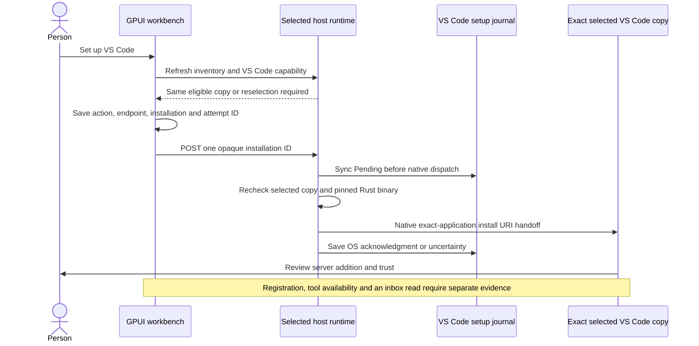

# VS Code native inbox setup

The general GPUI workbench can hand a fixed Rust inbox configuration to an exact selected VS Code application copy. VS Code owns the server-addition and trust decisions. An OS acknowledgment records the handoff, not a working MCP connection.

This document describes the source implementation. Deployment and actual VS Code client acceptance require separate receipts. Existing Cursor windows, receipts, and dated human reports remain separate.



## Runtime options

VS Code setup is disabled by default. Its two owner options are:

```text
--vscode-mcp-binary /absolute/owned/chinwag-bus-mcp
--vscode-mcp-journal /absolute/private/vscode-setup-journal
```

Both options are required together. They require `serve-local` or `serve-shared`, `--native-main-loop`, and an explicit `--onboarding-journal`. The native main loop services dispatch on the target host. A read-only bus can offer setup without enabling message publication.

The binary must be an owned, regular native executable with owner execute permission and no group or other write permission. The runtime pins its file identity, metadata, and SHA256, then revalidates them before each handoff. This is a file-replacement check, not vendor authentication.

The ordinary opening, Cursor setup, and VS Code setup journals use separate directories and immutable domains:

| Controller | Owner option | Persisted domain |
| --- | --- | --- |
| Ordinary opening | `--onboarding-journal` | `ordinary_open` |
| Cursor setup | `--cursor-mcp-journal` | `cursor_mcp_setup` |
| VS Code setup | `--vscode-mcp-journal` | `vscode_mcp_setup` |

An action cannot adopt another domain's records after restart. Unmarked legacy records belong only to ordinary opening. Conflicting or invalid domain metadata disables the affected controller and preserves its files. Setup initialization failure does not disable healthy bus service or another setup controller.

## Fixed configuration

The runtime supplies this configuration to VS Code:

```text
name: chinwag-native-inbox-mgmt
type: stdio
command: the exact owner-declared Rust MCP executable
args: --bus-url http://127.0.0.1:<this-runtime-port>
      --allow-room #mgmt --lease-seconds 900
```

VS Code and its MCP child run on the selected runtime host. A MacBook SSH-forward address is not substituted for a Studio-local endpoint. Setup requires a fixed nonzero runtime port. The generated configuration contains no shell wrapper, environment file, credentials, sender, model options, or workspace interpolation.

The supported install URI is `vscode:mcp/install?` followed by the whole JSON server object, encoded with `encodeURIComponent` semantics. The name is inside that object. The URI uses neither Cursor's Base64 payload nor a `servers` wrapper. Callers cannot supply an arbitrary URI or command through the runtime API.

The target must be an observed `visual_studio_code` application copy. Command-line candidates, Cursor, and other editor families are ineligible even if a capability response lists their IDs. The host reobserves the selected public application metadata before dispatch. Public metadata does not authenticate a vendor, account, or AI session. VS Code Insiders and unrelated editor forks are outside this setup action.

## Workbench behavior

**Find apps** requests VS Code setup capability when its inventory includes a VS Code application. An eligible copy receives **Set up VS Code**. The focused Cursor entry has no VS Code setup action and keeps its existing request flow.

A setup click refreshes the selected copy and capability on the same endpoint before creating Pending. A changed copy, failed refresh, stale endpoint, or newer UI generation creates no attempt and sends no setup POST. An unresolved action for the same installation blocks another opening or setup before refresh begins.

GPUI saves `OpeningAction::VsCodeMcpSetup`, serialized as `vscode_mcp_setup`, with the original endpoint, installation ID, and request ID. Older rows without an action still mean ordinary opening. Unknown action values are rejected rather than routed elsewhere.

After a validated OS acknowledgment, the button says **VS Code setup request sent** and remains disabled for that exact endpoint and installation. This decision searches the full bounded opening history, not a recent display subset. A stale enabled frame cannot repeat the request. There is no automatic resend or renewal.

The receipt says that server addition, trust, and an inbox read remain unverified. The person completes VS Code's own server-addition and trust flow. This unit does not change client settings, approve tools, restart VS Code, sign in, or invoke a model. Cursor's separate dated human confirmation remains historical evidence for Cursor only.

## Loopback API and recovery

| Route | Result |
| --- | --- |
| `GET /api/onboarding/vscode-mcp/status` | Read eligible opaque VS Code installation IDs. No scan or setup dispatch. |
| `POST /api/onboarding/vscode-mcp/setup` | Consume one human setup attempt with one opaque installation ID and request ID. |
| `GET /api/onboarding/vscode-mcp/setups/<request ID>` | Read the original saved receipt. Never submit a setup request. |

The routes require the existing loopback Host, no-Origin boundary, and exactly one `X-Chinwag-Onboarding-Intent: 1` header. The intent header is a native-client convention, not person or application authentication. Unknown JSON fields, paths, commands, query parameters, invalid IDs, and unsupported methods are rejected.

The runtime syncs Pending before any native dispatch. Reusing an ID returns that domain's recorded outcome without another handoff. A conflicting payload is rejected. A crash-left Pending record remains uncertain. UI recovery uses the saved action and original endpoint with GET only, including after restart. A missing receipt does not prove that VS Code received no request.

VS Code setup can be unavailable on an older runtime while inventory, ordinary opening, and Cursor setup continue to work. Its 404 response becomes a VS Code capability notice. It does not disconnect bus history or authorize another POST.

## Lease and acceptance limits

The server has one owner-local, unattributed, read-only native `#mgmt` grant. Its lease lasts 900 seconds. An installed or registered VS Code server entry can outlive that original process lease. Registration is not continuing permission to read. The server does not renew its lease or launch a model automatically.

An OS receipt does not prove server registration, trust approval, an MCP handshake, tool availability, account identity, or an actual inbox read. Each needs its own observation. A successful SDK fixture is separate from actual VS Code acceptance. The current in-process MCP observations do not supply a live GPUI connection state.

The inbox reads the native coordination ledger's `#mgmt` room. It does not establish delivery into Grok Bot's MGMT group. Message bodies remain untrusted data.

## Primary sources

Microsoft's [MCP developer guide](https://code.visualstudio.com/api/extension-guides/ai/mcp) specifies the install URI and JSON encoding. Its [MCP configuration reference](https://code.visualstudio.com/docs/agents/reference/mcp-configuration) defines stdio fields and the separate `code --add-mcp` option. This unit uses exact-application URI dispatch rather than that CLI option or private configuration edits.

See [Human onboarding](HUMAN_ONBOARDING.md), [Cursor setup](CURSOR_MCP_SETUP.md), and [MCP connection observations](MCP_CONNECTION_OBSERVATIONS.md) for their separate contracts.
