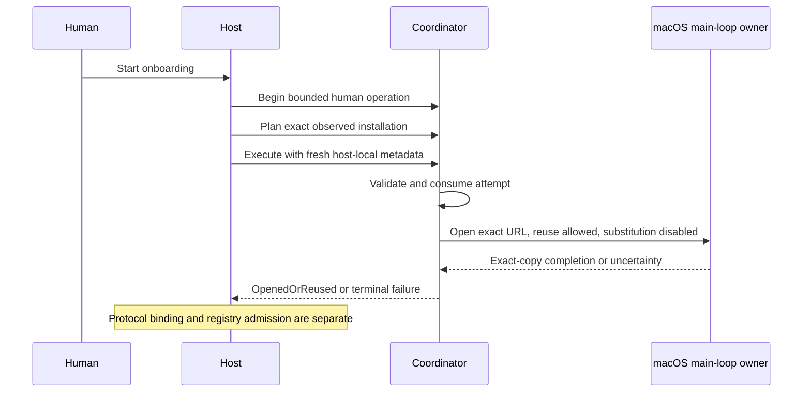

# Human-scoped native application opening

This component prepares and consumes an opaque plan to open one exact installed application during a human-started onboarding operation. It does not attach a client to Chinwag or create a connector grant.

The trusted host creates the human operation. A public process name, installation row, family label or JSON field is not human authorization. Host and boot identity, operation generation, exact installation, public metadata fingerprint and monotonic deadlines bind the plan. Plans and targets cannot be deserialized from a caller's request. The host must supply fresh observations from its own bounded collector.

Version1 accepts declared native application recipes with exact bundle/executable metadata and a Mach-O executable. It rejects command-line programs, scripts, launcher-only entries and name-only matches. Public metadata remains an observation; it is not code-signature verification or proof of a vendor, account or model.

One selected path receives one plan per operation. An attempt is consumed before it can reach the executor, including a later revalidation failure. The execution deadline is the earlier of the operation deadline and the fresh observation's expiry. Replaced metadata, another host or boot, stale generations, cancellation and foreign coordinator handles cannot dispatch. A missing process observation never establishes that an app is asleep.

The macOS executor requests the exact application URL with new-instance creation and running-application substitution disabled. It must validate the returned application and executable URLs and bundle identifier. No shell, CLI arguments, environment injection, account selection, model turn, process termination or restart is part of this interface. Reused applications remain externally owned.

The executor requires a serviced native main queue on the target host and a background caller. The default Tokio alpha runtime does not own that queue. The explicit `--native-main-loop` option for `serve-local` or `serve-shared` runs the existing Tokio server work on an owned worker while the process main thread services the native queue. It changes no launch permission and exposes no new HTTP route, GPUI launch control or native-open plugin capability. Successful compilation, fake-executor tests and a queue-only probe do not establish that a real app launched on either host.

`run_main_loop_host(work)` owns an idle native source and joins its worker before cleanup. Its lifetime depends on that work returning; cancellation is cooperative. It does not forcibly stop a thread or another application. The queue-only probe preserves immediate-success and inner-error results across serial host scopes, then checks a Rust dispatch closure on the actual main thread. It uses no application-opening API.

Requested AppKit error/auth prompts are disabled. The installed SDK explicitly states that Gatekeeper can still present its own access UI. This code neither bypasses Gatekeeper nor guarantees a prompt-free launch.

After possible OS submission, cancellation, timeout, a missing callback or an inconsistent completion is **uncertain**. The consumed attempt cannot be replayed automatically. A late callback cannot create a connector binding or change user identity. `OpenedOrReused` means only that macOS acknowledged the selected application copy; it does not mean connected, signed in, ready or delivered.

`chinwag_client_discovery::reobserve_application` provides bounded exact-target public metadata refresh. It validates fixed depth-one public scope and carried aliases before I/O, holds directory descriptors with `NOFOLLOW` and rejects changed targets. It does not rescan installed applications or process state and does not establish executable authenticity. Application fingerprints now include parent-directory and plist identity; older application observations need a fresh inventory before use.

Before launch-route wiring, the host must connect the explicit human-action boundary and fresh exact-target observation to durable attempt/uncertainty handling and stale-result protection. It must preserve those boundaries across process restart and loss of the UI connection. The existing connector registry remains the authority for later protocol capabilities.

Validation uses synthetic installation observations and fake executors. The platform module is compiled and its pure result/race logic is tested without requesting a real application launch.
