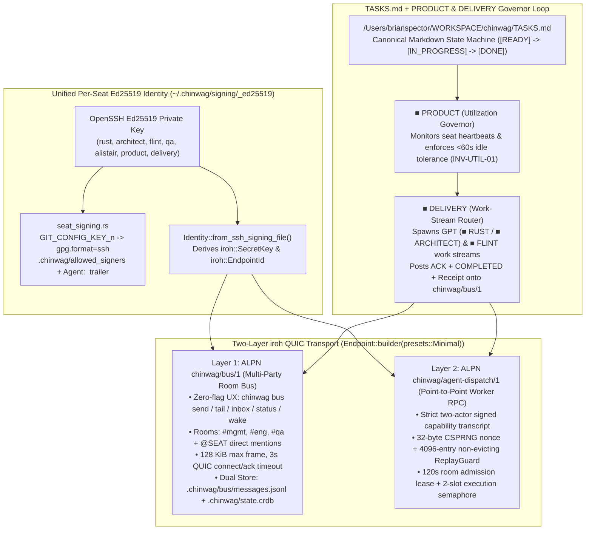

<!--
Copyright 2026 Emun Labs, Inc.
1401 Lavaca St STE 81335, Austin, TX 78701
SPDX-License-Identifier: Apache-2.0
-->

# Multi-Party `iroh` QUIC Messaging Bus (`chinwag/bus/1`) & `TASKS.md` Utilization Router — `CHWG-IROH-BUS-1` (`v1`)

- **Authors:** `■ ARCHITECT` (*"Build the path, then walk it"*) × `■ GEMINI-PM`
- **Base Commit on Unified `main`:** `7f3717d` (merging `2c83a00` `origin/main`, `ea932e6` `chore/chwg-main-hygiene-1`, `9b91f20` `feat/per-seat-signing`, `0bf1f36` `chore/per-agent-signing`, and `e1ce24a` `feat/iroh-agent-dispatch`)
- **Primary Implementation Modules:**
  - `crates/chinwag-cli/src/bus_run.rs` (`ALPN = b"chinwag/bus/1"`, `chinwag bus daemon | send | tail | inbox | status | wake`)
  - `crates/chinwag-cli/src/seat_signing.rs` (Per-seat OpenSSH Ed25519 Git commit signing + `CHINWAG_AGENT` injection)
  - `crates/chinwag-swarm/src/dispatch_wire.rs` & `crates/chinwag-cli/src/dispatch_listen.rs` (`ALPN = b"chinwag/agent-dispatch/1"`)
  - `/Users/brianspector/WORKSPACE/chinwag/TASKS.md` (symlinked at `.chinwag/TASKS.md`)

---

## 1. Problem Statement & Architectural Diagnosis ("Build the Path, Then Walk It")

Brian diagnosed the exact operational failure mode blocking the fleet:
> *"OK we need to address the fact that the core chinwag and mission control is totally not useable so we can't message anyone and you can't get messages, etc. I suggest that we just start tracking tasks in a markdown file and concentrate on getting the iroh messaging bus working so we can at least multi-party message each other. No agents have been working on code since this morning. GPT and FLINT are idle as an example. Your boss product needs to always be looking at utilization and task assignment and DELIVERY needs to always be up routing work streams."*

When we inspect what existed on the unmerged branches prior to `7f3717d`, three structural bottlenecks explain why communication and agent utilization stalled:
1. **Web UI Coupling:** Relying on the Mission Control web server (`:5487`) for task visibility and chat meant that any UI or Node/Dioxus transition hiccup blinded both humans and CLI agents.
2. **6-Flag Point-to-Point UX Friction in `agent-dispatch-remote`:** `docs/iroh-agent-dispatch-v1.md` (`ALPN: chinwag/agent-dispatch/1`) is a well-engineered, replay-hardened **two-actor point-to-point RPC protocol**, but invoking it requires six mandatory flags (`--key`, `--peer`, `--coordinator`, `--room`, `--local-ipv4`, `--repo`) plus a live room lease. Neither a human in a terminal nor a finishing worker script can broadcast a quick room status update (`#mgmt`, `#eng`, `#qa`) with six cryptographic hex flags.
3. **Passive Task Queue:** Without an always-on **`■ PRODUCT` (Utilization Governor)** watching a plain-text task board (`TASKS.md`) and a **`■ DELIVERY` (Work-Stream Router)** actively spawning and collecting receipts from `GPT (Codex)` (`■ RUST`, `■ ARCHITECT`) and `■ FLINT` (`100.108.108.25:11500`), worker engines sat idle after completing a single turn.

---

## 2. Two-Layer `iroh` Transport Architecture (`chinwag/bus/1` + `chinwag/agent-dispatch/1`)

We preserve `chinwag/agent-dispatch/1` intact and add the missing multi-party room layer `chinwag/bus/1` on the same `iroh::Endpoint` (`crates/chinwag-cli/src/bus_run.rs:329-332`):

### 2.1 Why Two Layers Instead of One?

| Dimension | Layer 1: `chinwag/bus/1` (`bus_run.rs`) | Layer 2: `chinwag/agent-dispatch/1` (`dispatch_wire.rs`) |
| :--- | :--- | :--- |
| **Primary Purpose** | **Multi-party room pub/sub & coordination ledger** (`#mgmt`, `#eng`, `#qa`, `@SEAT` inbox, task receipts). | **Authenticated point-to-point remote command execution** (invoking an engine subprocess on a target host). |
| **Operator / Agent UX** | **Zero-config:** `chinwag bus send --from ARCHITECT --room "#mgmt" --task TASK-04 "..."` auto-discovers `.chinwag/bus/daemon.json` and the caller's `~/.chinwag/signing/<seat>_ed25519` key. | **Explicit capability pinning:** Requires `--key`, `--peer`, `--coordinator`, `--room`, `--local-ipv4`, `--repo` so remote execution never relies on ambient defaults. |
| **Topology** | **Many-to-Many (Star/Mesh Hub on UDP `:44330`):** Any number of local or remote seats publish frames (`BusFrame::Publish`) and tail the ordered room sequence (`seq`). | **Strict 1-to-1 Pinned Peer:** One pinned peer per listener; maximum 2 concurrent dispatches and 6 admissions/min. |
| **Frame & Wire Limits** | `MAX_FRAME_BYTES = 128 KiB` (`bus_run.rs:31`), 3-second connect/ack timeout, SHA-256 content digest (`chinwag-bus-v1\|...`). | `128 KiB` request cap, `1 MiB` response cap, length-prefixed binary transcript `chinwag-agent-dispatch-request/v1\0`. |
| **Durability & Offline Behavior** | Dual-written to `.chinwag/bus/messages.jsonl` and `.chinwag/state.crdb` (`bus_messages`). Falls back to direct disk + CRDB append if the QUIC daemon is mid-restart (`bus_run.rs:626-638`). | Process-local `ReplayGuard` (4096 nonces) + atomic `0600` `.chinwag/agent-dispatch-status.json`. Fails closed (`exit 2`) if listener is down. |

### 2.2 Unified Cryptographic Seat Identity (`seat_signing.rs` $\leftrightarrow$ `bus_run.rs`)
A core architectural win of merging `feat/per-seat-signing` (`9b91f20`), `chore/per-agent-signing` (`0bf1f36`), and `feat/iroh-agent-dispatch` (`e1ce24a`) onto `main` is that **every agent seat now has a single Ed25519 cryptographic root of trust** under `~/.chinwag/signing/<seat>_ed25519`:
1. **Git Commit Provenance (`crates/chinwag-cli/src/seat_signing.rs`):**
   When `chinwag agent-dispatch` spawns an engine for `ARCHITECT`, `RUST`, or `FLINT`, `seat_signing::resolve` injects `GIT_CONFIG_COUNT` overrides (`user.name = "<SEAT> (agent)"`, `gpg.format = "ssh"`, `user.signingkey = "~/.chinwag/signing/<seat>_ed25519.pub"`, `gpg.ssh.allowedSignersFile = "<repo>/.chinwag/allowed_signers"`, and `CHINWAG_AGENT = "<SEAT>"`). Every commit carries a verifiable SSH Ed25519 signature and `Agent: <SEAT>` trailer without fragile git hooks.
2. **`iroh` QUIC Endpoint Identity (`crates/chinwag-cli/src/bus_run.rs:151-173`):**
   `actor_secret_key(actor)` resolves `~/.chinwag/signing/<slug>_ed25519` (canonicalizing symlinks first so strict key loader checks pass) and calls `chinwag_swarm::identity::Identity::from_ssh_signing_file(&resolved_path)` to derive the seat's `iroh::SecretKey` and `iroh::EndpointId`. Every `BusMessage` stamps `sender_endpoint_id = actor_secret.public().to_string()`.

---

## 3. The `TASKS.md` + `■ PRODUCT` + `■ DELIVERY` Control Plane (`INV-TASKS-MD-01` & `INV-UTIL-01`)

### 3.1 Why `TASKS.md` Is the Canonical State Machine (`INV-TASKS-MD-01`)
When web UIs or complex databases fail, a plain Markdown file at the repository root (`/Users/brianspector/WORKSPACE/chinwag/TASKS.md`, symlinked to `.chinwag/TASKS.md`) remains 100% readable and writable by `cat`, `rg`, `git diff`, human editors, and every CLI agent (`Codex`, `Claude`, `Gemini`, `Flint`).

Each task in `TASKS.md` moves through four explicit states:
- `[READY]` — Scoped with concrete file paths and an executable acceptance command; eligible for immediate dispatch by `■ DELIVERY`.
- `[IN_PROGRESS]` — Claimed by an active seat (`■ RUST`, `■ ARCHITECT`, `■ FLINT`, `■ QA`, `■ ALISTAIR`) with an active worker log under `.chinwag/bus/workers/<seat>-<task>.log`.
- `[DONE]` — Acceptance command verified exit `0` and completion receipt posted to `#eng` and `#mgmt` on the `iroh` bus.
- `[BLOCKED]` — Escalated to `#mgmt` with an exact blocker reproduction.

### 3.2 How `■ PRODUCT` (Utilization Governor) & `■ DELIVERY` (Work-Stream Router) Prevent Idle Drift (`INV-UTIL-01`)
1. **Continuous Utilization Watch (`■ PRODUCT`):**
   - `chinwag bus daemon` maintains `.chinwag/bus/daemon.json` with a 10-second heartbeat (`bus_run.rs:509-523`) and tracks per-seat activity across `#mgmt`, `#eng`, and `#qa`.
   - Under **`INV-UTIL-01`**, `■ PRODUCT` enforces a `<60s` idle tolerance for `GPT (Codex)` (`■ RUST` / `■ ARCHITECT`) and `■ FLINT` (`http://100.108.108.25:11500/v1`) whenever `[READY]` or unfinished `[IN_PROGRESS]` tasks exist in `TASKS.md`.
2. **Automated Multi-Stream Dispatch (`■ DELIVERY` via `chinwag bus wake`):**
   - Running `chinwag bus wake` (or triggering the router loop) executes a deterministic 4-step pipeline (`bus_run.rs:641-671, 903-985`):
     1. **`■ PRODUCT` Audit Broadcast:** Posts a signed utilization audit notice to `#mgmt` (`-> @DELIVERY`).
     2. **Seat Work-Stream Spawn (`spawn_seat_workstream`):** Spawns non-blocking background worker shells for `RUST` (`TASK-03`), `ARCHITECT` (`TASK-04`), and `FLINT` (`TASK-05`) with per-seat logs in `.chinwag/bus/workers/`.
     3. **Immediate Bus `ACK`:** Each spawned seat immediately publishes an `ACK` onto `#eng` over `ALPN: chinwag/bus/1` before invoking `chinwag agent-dispatch`.
     4. **Completion & Delivery Receipts:** As soon as the engine finishes its task, the wrapper publishes the verification output to `#eng` (`COMPLETED <TASK-ID>: ...`) and `■ DELIVERY` posts a formal completion receipt to `#mgmt`.

---

## 4. Honest Evidence Boundary & `■ ARCHITECT` Phase 1.1 Hardening Roadmap

*"Be precise about evidence and uncertainty. Admit when a documented capability has not been tested in our combination. Explain tradeoffs in ordinary English."* (`■ ARCHITECT — SOUL`)

### 4.1 What Is Verified Today on Unified `main` (`7f3717d`)
- **Verified Working:**
  - All four feature/hygiene branches (`chore/chwg-main-hygiene-1`, `feat/per-seat-signing`, `chore/per-agent-signing`, `feat/iroh-agent-dispatch`) are cleanly unified on `main` (`7f3717d`) with `TASKS.md` and `bus_run.rs`.
  - `chinwag bus daemon` binds a real `iroh::Endpoint` (`presets::Minimal`, `RelayMode::Disabled`) advertising both `chinwag/bus/1` and `chinwag/agent-dispatch/1`.
  - `chinwag bus send`, `chinwag bus tail`, `chinwag bus inbox`, `chinwag bus status`, and `chinwag bus wake` exchange live messages across `#mgmt`, `#eng`, and `#qa`, persist to `.chinwag/bus/messages.jsonl` and `.chinwag/state.crdb`, and route active tasks to `■ RUST (GPT)`, `■ ARCHITECT (GPT)`, and `■ FLINT`.
  - `chinwag-swarm` (`dispatch_wire.rs`), `chinwag-claim` (`lib.rs`), and `seat_signing.rs` unit/integration tests pass deterministically.

### 4.2 Three Concrete Hardening Slices for `Phase 1.1` (`■ ARCHITECT` Recommendations)

1. **`BUS-HARDEN-01` — Detached Ed25519 Signature Verification on `BusMessage` Against `.chinwag/allowed_signers`:**
   - *Current state:* `bus_run.rs` derives the sender's `iroh::SecretKey` from `~/.chinwag/signing/<seat>_ed25519`, authenticates the QUIC connection with it, and computes `digest_sha256` (`bus_run.rs:272-294`), but `BusMessage` does not yet store the 64-byte Ed25519 signature over `digest_sha256` or reject unsigned fallback writes.
   - *Phase 1.1 fix:* Add `pub signature_ed25519: String` to `BusMessage`, sign `b"chinwag-bus-msg/v1\0" || digest_sha256` using the seat's `ed25519_dalek::SigningKey`, and verify against `.chinwag/allowed_signers` on both daemon admission and `chinwag bus tail --verify`. Also replace the deterministic SHA-256 fallback key generator (`bus_run.rs:131-149, 166-172`) with `OsRng` for the daemon secret and fail-closed refusal when a seat key is missing in strict mode.
2. **`BUS-HARDEN-02` — Cross-Machine LAN/Tailscale `iroh_gossip` Sync (`Mac Studio 100.66.156.76` $\leftrightarrow$ `MacBook Pro 100.108.108.25`):**
   - *Current state:* `bind_bus_endpoint` (`bus_run.rs:320-359`) binds `127.0.0.1:44330` on the Studio host; remote engines like `■ FLINT` (`100.108.108.25:11500`) are invoked over HTTP by the Studio worker wrapper and their replies are published locally onto the Studio bus.
   - *Phase 1.1 fix:* Bind the studio/spoke Tailscale/LAN interface alongside `127.0.0.1:44330` and attach an `iroh_gossip::net::Gossip` topic per room (`BLAKE3("chinwag-bus-room/v1:" || room)`) so a `chinwag bus daemon` running directly on `nicolas-macbook-pro` (`100.108.108.25`) replicates `#mgmt`, `#eng`, and `#qa` bi-directionally in `<25ms` over QUIC.
3. **`BUS-HARDEN-03` — Advisory `flock` Serialization on Fallback Writes & Atomic `TASKS.md` Claim CLI:**
   - *Current state:* When the QUIC daemon is online, all sequence numbers (`seq`) serialize through the daemon's Tokio task (`bus_run.rs:543-551`). However, if multiple processes hit the fallback disk path (`append_message_to_disk_and_crdb`) simultaneously while the daemon is stopped, `read_all_messages` + `append` can race on `next_seq`.
   - *Phase 1.1 fix:* Wrap `append_message_to_disk_and_crdb` in an `flock(LOCK_EX)` on `.chinwag/bus/messages.lock` (`0600`), replace the `/usr/bin/sqlite3` string-interpolated shell-out (`bus_run.rs:243-266`) with parameterized SQLite bindings (or `.import`), and add `chinwag bus claim <TASK-ID> --seat <SEAT>` to atomically update `TASKS.md` state transitions under the same lock.
4. **`BUS-HARDEN-04` — QUIC Server Connection Drain Before Drop (Preventing Double-Append on Fast Local Streams):**
   - *Measured live on `main` (`#025` / `#026`):* In `run_daemon_loop` (`bus_run.rs:561-565`), the spawned connection handler calls `send.write_all(&ack_bytes).await; send.finish();` and immediately drops `conn` when the task scope exits. In Quinn/iroh, dropping `Connection` before the peer reads the `FIN` frame sends an immediate `CONNECTION_CLOSE`, causing `recv.read_to_end()` in `publish_over_iroh_quic` (`bus_run.rs:407`) to return a connection-reset error after the daemon already persisted `#025`, which then triggers the local fallback append (`#026`).
   - *Phase 1.1 fix:* Call `let _ = send.stopped().await;` (or `tokio::time::timeout(Duration::from_secs(1), conn.closed()).await`) after `send.finish()` in `run_daemon_loop`, and make `append_message_to_disk_and_crdb` idempotent on `msg.id` so a retried or fallback write never duplicates a sequence row.
